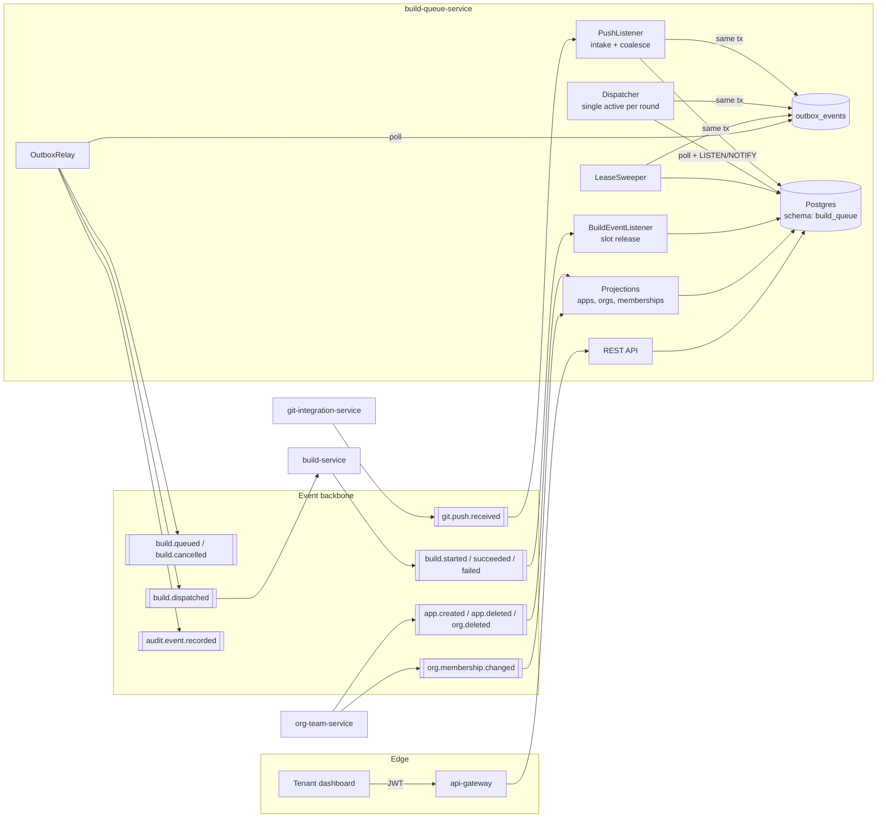
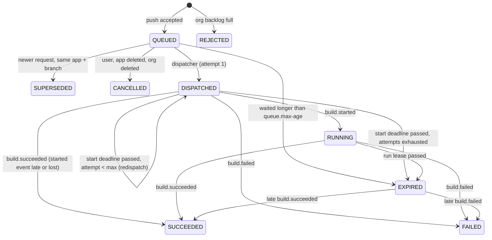
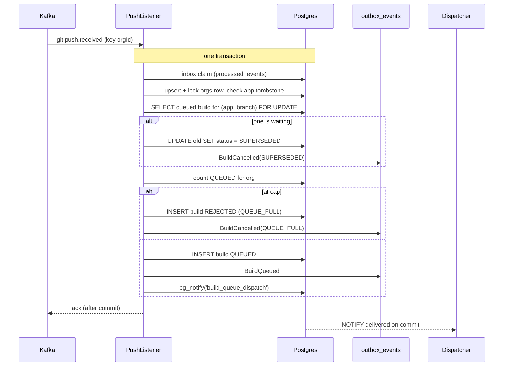
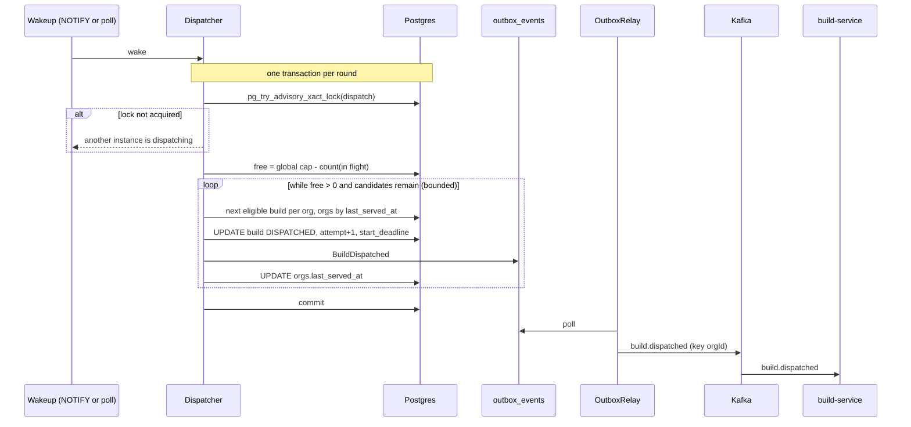
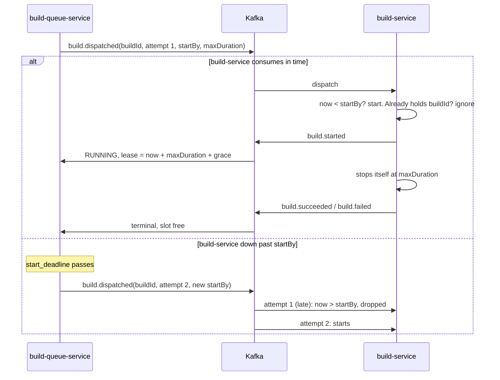
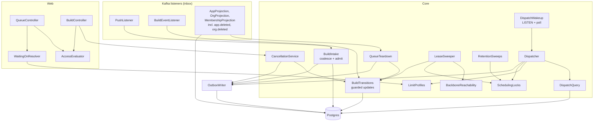

# build-queue-service: Architecture

Status: proposed design, pre-implementation. Second service of `PROJECT.md` Build roadmap phase 3
(the build pipeline), after `git-integration-service`. Several decisions below change shared
contracts or set requirements on `build-service`, which isn't designed yet. Each one that needs an
ADR is listed in [Decisions that need an ADR](#decisions-that-need-an-adr).

`PROJECT.md` gives this service one paragraph: it "consumes `git.push.received` events and decides
build priority and concurrency per org before handing jobs to `build-service`. This is where
backpressure gets handled instead of every push landing straight in a build queue with no limit."
`git-integration-service`'s design adds two expectations: the queue "coalesces rapid pushes (it may
skip building commit N when N+1 is already queued), but it never has to worry about going
backwards", and when an app is deleted while its push is still in flight, the queue "also sees
`app.deleted` and should drop it". This document is the full design.

Read these first, because this document assumes them rather than re-arguing them:
`docs/git-integration-service/ARCHITECTURE.md` §Event contracts, §Push to event and §The chain rule
(what arrives here, and why its order can be trusted),
[ADR-0020](../adr/0020-shared-transactional-outbox-and-inbox.md) and
[ADR-0017](../adr/0017-outbox-commit-order-and-relay-lock-timeout.md) (the outbox and inbox this
service uses), [ADR-0018](../adr/0018-multi-org-per-account-and-per-request-authorization.md) and
[ADR-0019](../adr/0019-membership-state-topic.md) (authorization against a local membership read
model), [ADR-0013](../adr/0013-per-service-api-path-namespace.md) (the API path), and
[ADR-0009](../adr/0009-temporal-for-saga-orchestration.md) (why this service does not use Temporal).

## Contents

- [Purpose](#purpose)
- [Position in the system](#position-in-the-system)
- [Design goals and non-goals](#design-goals-and-non-goals)
- [Why a queue service at all](#why-a-queue-service-at-all)
- [Domain model](#domain-model)
- [Data model](#data-model)
- [Event contracts](#event-contracts)
- [API](#api)
- [Authorization model](#authorization-model)
- [Processing pipelines](#processing-pipelines)
- [Scheduling policy](#scheduling-policy)
- [The dispatcher](#the-dispatcher)
- [Leases and deadlines](#leases-and-deadlines)
- [Contract with build-service](#contract-with-build-service)
- [Distributed systems mechanisms](#distributed-systems-mechanisms)
- [Consistency and failure modes](#consistency-and-failure-modes)
- [Security and threat model](#security-and-threat-model)
- [Observability and operations](#observability-and-operations)
- [Component view](#component-view)
- [Deployment and scaling view](#deployment-and-scaling-view)
- [Package layout and dependencies](#package-layout-and-dependencies)
- [Configuration](#configuration)
- [Changes this design needs elsewhere](#changes-this-design-needs-elsewhere)
- [Decisions that need an ADR](#decisions-that-need-an-adr)
- [Extension points](#extension-points)
- [Open questions / deferred](#open-questions--deferred)
- [Relationship to existing planning docs](#relationship-to-existing-planning-docs)

## Purpose

`build-queue-service` sits between "this app should build this commit" and "a builder is building
it". It owns the platform's build backlog and decides what runs next. The service:

- Turns every `git.push.received` into a queued build with a stable `buildId`, the identity the
  build carries through `build-service`, `registry-service` and the deploy saga.
- Coalesces: when a newer commit for the same app and branch arrives while an older one is still
  waiting, the older one is superseded and never built. A burst of ten pushes to `main` costs two
  builds at most (the one already running and the newest), not ten.
- Serializes per app: at most one build of an app is in flight at a time, so builds of one app
  finish in the order they were queued and the deploy path never sees two of them racing.
- Shares the build fleet fairly: each org gets at most its concurrency limit, the platform as a
  whole gets at most the fleet's capacity, and orgs with waiting work take turns. One org pushing a
  hundred times can't push another org's single build to the back.
- Applies backpressure: an org's backlog is bounded, a build that waits too long expires, and the
  queue hands `build-service` no more work than it said it can run.
- Notices a build that disappeared (dispatched and never started, or started and never finished)
  and gets its slot back, without double-running it.
- Shows a tenant why their build is waiting, and lets a developer cancel one that hasn't started.

It holds no credentials and calls no third party. Everything that crosses its boundary is a Kafka
event or an authenticated dashboard request.

## Position in the system



Three kinds of traffic cross this service's boundary:

1. Inbound events: `git.push.received` (work arriving), `build.*` from `build-service` (work
   finishing), and the org/app/membership events that feed its read models.
2. Outbound events, all through the transactional outbox: `build.queued`, `build.dispatched`,
   `build.cancelled`, `audit.event.recorded`.
3. Tenant requests through `api-gateway`: read the queue, read a build, cancel a queued build.

No synchronous call leaves this service. `build-service` never asks the queue for work and the
queue never asks `build-service` whether it's alive. Both directions are events, and the gaps
between them are covered by deadlines ([Leases and deadlines](#leases-and-deadlines)).

## Design goals and non-goals

Goals:

- Never lose a build request. Once `git.push.received` is acknowledged, its build is a row in
  Postgres, and every state change after that commits together with the event that announces it.
- Never build an older commit after a newer one for the same app and branch. `git-integration-service`
  publishes pushes in order per org; this service keeps that order and adds coalescing on top.
- Never run two builds of the same app at once. Enforced by a database constraint, not by the
  dispatcher being careful.
- Never let a redispatch make a build run twice. Redispatch is allowed; double execution is not,
  because `buildId` is the idempotency key end to end.
- Hand `build-service` no more concurrent work than the platform-wide capacity setting, and no
  org more than its own limit.
- Keep one org's burst from delaying another org's build beyond one turn of the round robin.
- Get a slot back from a build that vanished, but never conclude a build vanished just because
  this service couldn't hear about it.
- Bound everything: queue depth per org, time in queue, time to start, time to run, rows per
  dispatch round, rows kept after a build finishes.
- Tell a tenant, for every waiting build, what it is waiting on.

Non-goals (this design):

- Running builds, fetching source, or holding a credential. That is `build-service`'s job
  ([`git-integration-service` §Source access](../git-integration-service/ARCHITECTURE.md#source-access-for-the-build-pipeline)).
- Build logs, build history beyond the queue's own view, artifacts, or image metadata. Those
  belong to `build-service`, `log-service` and `registry-service`.
- Cancelling a build that has already been dispatched. v1 cancels only what hasn't left the queue
  ([Extension points](#extension-points)).
- Plan-based limits from billing. v1 reads limit profiles from configuration; `billing-service`
  feeding them is phase 7 ([Extension points](#extension-points)).
- Deciding whether a build should happen at all (skip markers, path filters, branch rules). That
  happened upstream in `git-integration-service`; this service trusts a request that arrives.
- Priority between orgs. Orgs are equal; priority exists only between an org's own builds.
- Autoscaling the build fleet. The queue publishes the signal (depth, saturation); acting on it is
  later work.

## Why a queue service at all

`build-service` could consume `git.push.received` directly. Kafka is already a queue. Several
things go wrong if it does:

| Need | Kafka partition as the queue | This service |
|---|---|---|
| Coalesce pushes to the same branch | A consumer can't see that a newer commit is behind this one without reading ahead and holding everything it read | A newer request supersedes the waiting one in one transaction |
| One build per app at a time | The consumer either blocks the partition (and every other app of that org, and every org sharing the partition) or tracks in-flight apps itself, which is this service | Partial unique index on in-flight builds |
| Fair share across orgs | Partitions are hashed by `orgId`; a hot org's partition starves every org that hashes with it, and an idle partition can't lend capacity | Round robin over orgs with waiting work, global and per-org caps |
| Bounded backlog per org | Kafka retention is the only bound | Per-org queue cap and maximum queue age |
| "Why is my build waiting?" | Unanswerable | Computed per waiting build |

So the queue is a scheduler with state, and the state lives in Postgres: it needs reads across
orgs, constraints, and row locks, which a log can't give it. Kafka stays the transport in and out,
so the service boundary rule holds: no Pallet service calls another one.

Temporal isn't used here. ADR-0009 scopes it to the deploy and billing sagas, and this service has
no multi-step process with compensations: each build is a short state machine whose transitions
are driven by events and deadlines, and Postgres rows with a sweeper model that directly.

## Domain model

One aggregate, `Build`, plus three read models.



| Status | In flight? | Terminal? | Meaning |
|---|---|---|---|
| `QUEUED` | no | no | Waiting for a slot. |
| `DISPATCHED` | yes | no | `build.dispatched` written to the outbox; waiting for `build-service` to start it before `start_deadline`. |
| `RUNNING` | yes | no | `build-service` reported it started; waiting for a result before `lease_expires_at`. |
| `SUCCEEDED`, `FAILED` | no | yes | `build-service` reported a result. Final; nothing moves them. |
| `SUPERSEDED` | no | yes | Replaced by a newer request for the same app and branch before it was dispatched. |
| `CANCELLED` | no | yes | Removed before dispatch by a person, or because its app or org was deleted. |
| `REJECTED` | no | yes | Never queued: the org's backlog was at its cap. |
| `EXPIRED` | no | almost | The queue stopped waiting: too long in the queue, never started, or no result before the run lease ran out. Only a late `build.succeeded` / `build.failed` from `build-service` can move it, because that's a fact about a build that really ran. |

Status moves forward only. Each status has a rank (`QUEUED 0 < DISPATCHED 1 < RUNNING 2 <
EXPIRED 3 < SUCCEEDED/FAILED 4`; `SUPERSEDED`, `CANCELLED`, `REJECTED` are 4 and reachable only
from `QUEUED` or intake), and every transition is an `UPDATE ... WHERE status IN (allowed
predecessors)`. A `build.started` that arrives after `build.succeeded` changes nothing.

**`buildId`** is a UUIDv5 over the `GitPushReceived.eventId` that requested the build, in a fixed
namespace. A redelivered push therefore names the same build before the inbox is even consulted,
and anyone holding the push event id can recompute the build id.

**`attempt`** counts dispatches of the same build. It is 1 on the first dispatch and grows only on
a redispatch after a missed start deadline. It's carried on `build.dispatched` so `build-service`
can tell a redispatch from a duplicate, but `build-service` keys execution on `buildId`, never on
`(buildId, attempt)`.

**Priority class** is derived from the push's `trigger`. A person waiting on a button outranks a
background push:

| Trigger | Class | Why |
|---|---|---|
| `MANUAL` | `INTERACTIVE` (0) | Someone clicked "Build" and is watching. |
| `LINKED` | `INTERACTIVE` (0) | Someone just linked the repository with "deploy now". |
| `WEBHOOK` | `AUTOMATIC` (1) | A push; nobody is waiting on this screen yet. |
| `RECONCILED` | `AUTOMATIC` (1) | Recovery of a missed push. |

Priority applies only inside an org ([Scheduling policy](#scheduling-policy)).

Read models:

- **`apps`**: `(appId, orgId, slug, status)` from `app.created` / `app.deleted`. Used to drop
  requests for deleted apps and to confirm an app never changes org.
- **`orgs`**: `(orgId, status, lastServedAt)`. Created on first sight (a push or an
  `org.membership.changed` record), marked `DELETED` on `org.deleted`. `lastServedAt` is the round
  robin's cursor.
- **`org_memberships`**: `(orgId, userId, role, status, sourceVersion)` from the compacted
  `org.membership.changed` topic, exactly as in `git-integration-service` (ADR-0019).

## Data model

Schema `build_queue`, owned by Flyway. Every timestamp is `timestamptz`, and every deadline is
computed from database `now()`, never an application clock, so instances with skewed clocks agree.

```sql
CREATE TABLE apps (
    app_id      text        PRIMARY KEY,
    org_id      text        NOT NULL,
    slug        text,
    status      text        NOT NULL CHECK (status IN ('ACTIVE', 'DELETED')),
    deleted_at  timestamptz,
    updated_at  timestamptz NOT NULL DEFAULT now(),
    UNIQUE (org_id, app_id)
);

CREATE TABLE orgs (
    org_id          text        PRIMARY KEY,
    status          text        NOT NULL CHECK (status IN ('ACTIVE', 'DELETED')),
    last_served_at  timestamptz,
    deleted_at      timestamptz,
    updated_at      timestamptz NOT NULL DEFAULT now()
);

CREATE TABLE org_memberships (
    org_id          text   NOT NULL,
    user_id         text   NOT NULL,
    role            text   NOT NULL,
    status          text   NOT NULL CHECK (status IN ('ACTIVE', 'REMOVED')),
    source_version  bigint NOT NULL,
    PRIMARY KEY (org_id, user_id)
);

CREATE TABLE builds (
    build_id             uuid        PRIMARY KEY,
    org_id               text        NOT NULL,
    app_id               text        NOT NULL,
    branch               text        NOT NULL,
    commit_sha           text        NOT NULL CHECK (commit_sha ~ '^[0-9a-f]{40}$'),
    push_event_id        uuid        NOT NULL UNIQUE,
    trigger              text        NOT NULL CHECK (trigger IN ('WEBHOOK', 'MANUAL', 'LINKED', 'RECONCILED')),
    priority_class       smallint    NOT NULL CHECK (priority_class IN (0, 1)),
    provider             text        NOT NULL,
    installation_id      bigint      NOT NULL,
    repo_id              bigint      NOT NULL,
    repo                 text        NOT NULL,
    root_directory       text,
    head_commit_message  text,
    head_commit_author   text,
    status               text        NOT NULL CHECK (status IN ('QUEUED', 'DISPATCHED', 'RUNNING',
                                         'SUCCEEDED', 'FAILED', 'SUPERSEDED', 'CANCELLED', 'REJECTED', 'EXPIRED')),
    status_reason        text,
    superseded_by        uuid        REFERENCES builds (build_id) ON DELETE SET NULL
                                         DEFERRABLE INITIALLY DEFERRED,
    attempt              smallint    NOT NULL DEFAULT 0,
    enqueued_at          timestamptz NOT NULL DEFAULT now(),
    dispatched_at        timestamptz,
    start_deadline       timestamptz,
    started_at           timestamptz,
    lease_expires_at     timestamptz,
    finished_at          timestamptz,
    cancelled_by         text,
    traceparent          text,
    version              bigint      NOT NULL DEFAULT 0,
    FOREIGN KEY (org_id, app_id) REFERENCES apps (org_id, app_id),
    CHECK (status <> 'DISPATCHED' OR (start_deadline IS NOT NULL AND attempt >= 1)),
    CHECK (status <> 'RUNNING'    OR (started_at IS NOT NULL AND lease_expires_at IS NOT NULL)),
    CHECK (status <> 'SUPERSEDED' OR status_reason = 'SUPERSEDED'),
    CHECK (finished_at IS NOT NULL OR status IN ('QUEUED', 'DISPATCHED', 'RUNNING'))
);

-- One build of an app in flight at a time. The dispatcher relies on it rather than enforcing it.
CREATE UNIQUE INDEX ux_builds_app_in_flight ON builds (app_id)
    WHERE status IN ('DISPATCHED', 'RUNNING');

-- One waiting build per app and branch: coalescing is a constraint.
CREATE UNIQUE INDEX ux_builds_app_branch_queued ON builds (app_id, branch)
    WHERE status = 'QUEUED';

-- The dispatcher's candidate scan: waiting builds per org in priority order.
CREATE INDEX ix_builds_queued ON builds (org_id, priority_class, enqueued_at)
    WHERE status = 'QUEUED';

-- In-flight counting per org, and the lease sweeper.
CREATE INDEX ix_builds_in_flight ON builds (org_id) WHERE status IN ('DISPATCHED', 'RUNNING');
CREATE INDEX ix_builds_start_deadline ON builds (start_deadline) WHERE status = 'DISPATCHED';
CREATE INDEX ix_builds_lease ON builds (lease_expires_at) WHERE status = 'RUNNING';
CREATE INDEX ix_builds_queue_age ON builds (enqueued_at) WHERE status = 'QUEUED';

-- History and retention.
CREATE INDEX ix_builds_app_history ON builds (org_id, app_id, enqueued_at DESC);
CREATE INDEX ix_builds_finished ON builds (finished_at) WHERE finished_at IS NOT NULL;
CREATE INDEX ix_builds_superseded_by ON builds (superseded_by) WHERE superseded_by IS NOT NULL;

-- One row: when the lease sweeper last found the backbone unreachable (null when it's reachable).
CREATE TABLE lease_sweeper_state (
    id                  smallint    PRIMARY KEY CHECK (id = 1),
    unreachable_since   timestamptz
);
INSERT INTO lease_sweeper_state (id) VALUES (1);
```

`outbox_events` and `processed_events` are created by this service's own migration, copied from
`platform-common-outbox`'s `META-INF/pallet/outbox/reference-schema.sql` (ADR-0020: services own
the DDL).

Notes on the constraints:

- The composite foreign key to `apps (org_id, app_id)` makes a build under the wrong org
  impossible to insert, whatever the listener does.
- `ux_builds_app_in_flight` is the "one build per app" rule. If two dispatcher rounds ever
  overlapped (they shouldn't, see [The dispatcher](#the-dispatcher)), the second update would fail,
  its transaction would roll back, and nothing would be published.
- `ux_builds_app_branch_queued` is the coalescing rule. Intake must mark the old row `SUPERSEDED`
  before inserting the new one, in the same transaction; the other order fails.
- `EXPIRED` isn't in the in-flight set. When a lease expires the slot is free at once, and a late
  result moving the row to `SUCCEEDED` doesn't take it back.
- `superseded_by` is `ON DELETE SET NULL` and indexed, so retention can purge a row other rows
  point at.
- `head_commit_message` and `head_commit_author` are untrusted text copied from the push event,
  stored only to show in the queue view.
- `dispatched_at` is the first dispatch's time and a redispatch leaves it alone, so the queue wait
  and the start latency are measured from attempt 1 whatever happens after it.

## Event contracts

### Consumed

| Event | Source | Effect here |
|---|---|---|
| `GitPushReceived` | git-integration-service | Intake: create a `Build`, supersede the waiting one for the same app and branch, or reject at the org's cap ([Intake](#intake)). |
| `BuildStarted` | build-service | `DISPATCHED → RUNNING`, start the run lease. |
| `BuildSucceeded`, `BuildFailed` | build-service | `DISPATCHED`/`RUNNING`/`EXPIRED → SUCCEEDED`/`FAILED`. The slot is free once the row leaves the in-flight set. |
| `AppCreated` | org-team-service | Insert into `apps` if absent. Never changes an existing row. |
| `AppDeleted` | org-team-service | Mark the app `DELETED` (insert it already deleted if unknown); cancel its `QUEUED` builds (`APP_DELETED`). In-flight builds finish or expire normally. |
| `OrgDeleted` | org-team-service | Mark the org `DELETED`, its memberships `REMOVED`; cancel every `QUEUED` build (`ORG_DELETED`). |
| `OrgMembershipChanged` | org-team-service | Upsert the membership if `membershipVersion` is newer (ADR-0019). |

Every listener runs in a transaction whose first statement is the inbox claim, with the same one
exception `git-integration-service` makes: the membership listener's idempotency is the version
check, so a rebuild can replay the compacted topic from offset zero.

Kafka keeps no order across topics. The read models are written so that order doesn't matter:

- `AppDeleted` for an unknown app inserts it `DELETED`, so a late `AppCreated` can't revive it.
- A push for an app this service hasn't seen yet inserts the app `ACTIVE` under the push's org.
  `git-integration-service` only publishes for apps it knows from `app.created`, so the app
  exists; this service's projection is just behind. A later `AppCreated` for it is a no-op.
- An `appId` seen under a second org is a poison message: it's dead-lettered and alerted on, never
  applied. An app never changes tenant.
- A push for a `DELETED` app or org is acknowledged and counted
  (`build_queue.requests.dropped{reason}`), with no build row written. The tombstones are kept
  longer than `git.push.received`'s retention ([Retention](#retention)), so a push that was sitting
  in a topic when its app was deleted still finds the tombstone.

### Published

Every event is appended to the outbox in the same transaction as the state change that produced
it, and keyed by `orgId`, like every event on the backbone. Event ids are deterministic (UUIDv5
over `buildId` and a discriminator: `queued`, `dispatched:<attempt>`, `cancelled`), so a
rolled-back and retried transaction can't produce a second event with a different identity.

| Event | Topic | Trigger | Consumers |
|---|---|---|---|
| `BuildQueued` | `build.queued` | A build entered the queue | none in phase 3 (`git-integration-service` check runs and the dashboard later, see [Extension points](#extension-points)) |
| `BuildDispatched` | `build.dispatched` | The dispatcher gave a build a slot, or redispatched it | build-service |
| `BuildCancelled` | `build.cancelled` | A build left the queue without a result from `build-service`: superseded, cancelled, rejected, or expired | none in phase 3 (as `BuildQueued`) |
| `AuditEventRecorded` | `audit.event.recorded` | A person cancelled a build | audit-log-service (future) |

`build.dispatched` is a command-style topic like `notification.requested`: one intended consumer,
same envelope and delivery as a fact, and still named for what already happened ("the queue
dispatched this build"). It goes in the command-style group of `Topics`.

**`BuildQueued`**: `buildId`, `appId`, `branch`, `commitSha`, `pushEventId`, `trigger`,
`supersedes` (the `buildId` it replaced, or null).

**`BuildDispatched`** carries everything `build-service` needs to run the build without asking
anyone, and nothing secret:

| Field | Type | Meaning |
|---|---|---|
| `buildId` | string (UUID) | The build's identity, and `build-service`'s idempotency key. `BuildStarted`/`Succeeded`/`Failed` carry it back. |
| `attempt` | int | 1 for the first dispatch; higher for a redispatch of the same build. |
| `appId`, `branch`, `commitSha` | string | What to build. |
| `pushEventId` | UUID | The `GitPushReceived.eventId`, passed through so `BuildStarted.pushEventId` can carry it to `git-integration-service`'s check runs. |
| `trigger` | string | Passed through from the push. |
| `provider`, `installationId`, `repoId`, `repo` | | Where to fetch from. `repo` is display only; `repoId` is the identity. |
| `rootDirectory` | string | The directory to build, fixed at push time. |
| `startBy` | instant | Don't start this attempt after this time ([Leases and deadlines](#leases-and-deadlines)). |
| `maxDurationSeconds` | long | Hard limit on the build's running time. `build-service` stops the build and reports `build.failed` when it's reached. |

No installation token, no URL with a credential in it, no environment variable. Source credentials
are `build-service`'s own decision
([`git-integration-service` §Source access](../git-integration-service/ARCHITECTURE.md#source-access-for-the-build-pipeline)).

**`BuildCancelled`**: `buildId`, `appId`, `commitSha`, `pushEventId`, `reason`, `supersededBy`
(nullable). `reason` is one of:

| Reason | From | Meaning |
|---|---|---|
| `SUPERSEDED` | `QUEUED` | A newer request for the same app and branch replaced it. |
| `USER_CANCELLED` | `QUEUED` | A developer cancelled it. |
| `APP_DELETED`, `ORG_DELETED` | `QUEUED` | Its app or org went away. |
| `QUEUE_FULL` | intake | The org's backlog was at its cap; the build was never queued. |
| `QUEUE_TIMEOUT` | `QUEUED` | Waited longer than `queue.max-age`. |
| `START_TIMEOUT` | `DISPATCHED` | Dispatched `dispatch.max-attempts` times and never started. |
| `LEASE_EXPIRED` | `RUNNING` | Started, but no result arrived before the run lease ran out. The queue stopped waiting; the build may still report later. |

For the last two, "cancelled" means the queue gave up on the build, not that it stopped it. The
event exists so a later consumer (a check run, a dashboard) can close what `build.queued` opened
without waiting for a result that may never come.

`BuildStarted`, `BuildSucceeded` and `BuildFailed` already exist in `platform-common-events` as the
minimal contract `git-integration-service` needed (`buildId`, `appId`, `commitSha`, `pushEventId`,
plus `reason` on a failure). This service needs nothing more from them, with one condition:
`buildId` is the id from `build.dispatched`, not one `build-service` makes up
([Contract with build-service](#contract-with-build-service)).

## API

Base path `/api/v1/build-queue` (ADR-0013), routed by `api-gateway`. Every response is
`ApiResponse<T>`; lists are `PageResponse<T>`. `{orgId}` is a path parameter checked against the
membership read model on every request (ADR-0018), never a token claim.

| Method | Path | Role | Behavior |
|---|---|---|---|
| `GET` | `/orgs/{orgId}/queue` | VIEWER+ | The org's active builds (`QUEUED`, `DISPATCHED`, `RUNNING`): in-flight first, then waiting ones in the order the dispatcher would take them. Each waiting build carries `position` (1-based within the org, across pages) and `waitingOn` ([below](#waiting-on)). A `usage` block: `inFlight`, `maxConcurrent`, `queued`, `maxQueued`, `profile`, `dispatchPaused`. Paged; the order is fixed and `sort` is ignored. Read in one repeatable-read transaction, so positions, reasons and usage come from the same snapshot. |
| `GET` | `/orgs/{orgId}/apps/{appId}/builds` | VIEWER+ | The app's builds, newest first, every status, filterable by one or more `status` values (an unknown one is `400`). A deleted app's history stays readable. Paged; `sort` is ignored. Retention bounds the history ([Retention](#retention)). |
| `GET` | `/orgs/{orgId}/builds/{buildId}` | VIEWER+ | One build, including `statusReason`, `supersededBy`, `attempt` and timestamps. |
| `POST` | `/orgs/{orgId}/builds/{buildId}/cancel` | DEVELOPER+ | Cancels a `QUEUED` build (`USER_CANCELLED`). Idempotent: cancelling a build that is already `CANCELLED` / `USER_CANCELLED` returns it unchanged with `200`. Any other status: `409 BUILD_NOT_CANCELLABLE` with the current status. |

There is no endpoint to enqueue a build. Builds come from `git.push.received`; a manual build is
requested from `git-integration-service`, which resolves the branch head on GitHub first.

### Waiting on

For each `QUEUED` build, the queue view says which rule is holding it, checked in this order:

| `waitingOn` | Rule holding it |
|---|---|
| `DISPATCH_PAUSED` | An operator paused dispatching (`dispatch.paused`). |
| `APP_BUSY` | Another build of this app is in flight. |
| `ORG_CONCURRENCY` | The org is at its `maxConcurrent`. |
| `PLATFORM_CAPACITY` | The platform is at `dispatch.global-concurrency`. |
| `NEXT_ROUND` | Nothing is holding it; it goes out on the next dispatcher round. |

This is computed when the view is read, not stored. It answers the question a developer actually
has ("is this my fault, my plan's, or the platform's?") without exposing other orgs' builds.

### Error catalog

All are `AppException` subclasses rendered by `GlobalExceptionHandler`.

| Code | Status | When |
|---|---|---|
| `ORG_NOT_FOUND` | 404 | No membership row for the caller, or the org is deleted. The two cases are byte-identical responses. |
| `NOT_A_MEMBER` | 403 | The caller's membership is `REMOVED`. |
| `INSUFFICIENT_ROLE` | 403 | A member below the endpoint's role floor. |
| `APP_NOT_FOUND` | 404 | No app with this id in this org. |
| `BUILD_NOT_FOUND` | 404 | No build with this id in this org. |
| `BUILD_NOT_CANCELLABLE` | 409 | The build is no longer `QUEUED`. `meta.status` carries the current status. |

## Authorization model

The same model as `git-integration-service`, built from the same pieces (ADR-0018, ADR-0019):

- The JWT supplies `sub` and nothing else this service decides on.
- `org_memberships` is a local read model of the compacted `org.membership.changed` topic. A
  request for `/orgs/{orgId}/...` loads the caller's row together with the `orgs` row: no
  membership row or a deleted org means `404 ORG_NOT_FOUND`, a `REMOVED` row `403 NOT_A_MEMBER`,
  the same table `git-integration-service` uses.
- Roles rank `VIEWER < DEVELOPER < ADMIN < OWNER`. Reads need VIEWER; cancelling needs DEVELOPER,
  the same role that can request a manual build in `git-integration-service`.
- Every repository method on a tenant table takes `orgId` explicitly, and every query filters by
  it. An ArchUnit rule fails the build otherwise. The cross-org queries the dispatcher and the
  sweepers need carry `@CrossTenant("reason")`, and there are only a few of them.
- A `buildId` or `appId` from another org is `404`, never `403`, so ids can't be probed.
- Session revocation (ADR-0015) through the shared Redis registry, as in every resource server.

**Rebuilding the membership read model.** The membership listener runs in its own consumer group
(`build-queue-service.membership-state`) with no inbox, so the table can be rebuilt from the
compacted topic alone: stop that consumer group, `TRUNCATE build_queue.org_memberships`, reset the
group's offsets for `org.membership.changed` to earliest, and start it again. The version check
makes the replay converge on the latest record of every membership. `apps` and `orgs` are never
rebuilt this way: they hold tombstones and `last_served_at` that no topic can reproduce, and
builds reference them.

## Processing pipelines

### Intake



Steps, in order, inside one transaction:

1. **Validate.** `orgId`, `appId`, `branch`, `commitSha` (40 lowercase hex), `installationId`,
   `repoId`, `trigger`, `provider` and `repo` must be present and well formed, and the record key
   must be the event's `orgId` (ordering is per key, so a push keyed otherwise has no order to rely
   on). A malformed event can't become valid on retry: it's dead-lettered at once (a non-retryable
   exception) and alerted on.
2. **Inbox claim.** A redelivered event stops here.
3. **Tombstones.** Insert the `orgs` row if absent, then lock it (`SELECT ... FOR UPDATE`). Org
   `DELETED` → drop, counted. App `DELETED` → drop, counted. App unknown → insert `ACTIVE` under
   this org. App known under another org → dead-letter.
4. **Coalesce.** `SELECT` the `QUEUED` build for `(appId, branch)` `FOR UPDATE`. If there is one,
   mark it `SUPERSEDED` with `superseded_by` = the new `buildId`, and append
   `BuildCancelled(SUPERSEDED)`. The newer request always wins, because `git.push.received` is
   keyed by `orgId` and `git-integration-service`'s chain rule already put pushes in order.
5. **Admit.** Count the org's `QUEUED` builds (the org row lock makes this exact against a
   concurrent cancel). At `maxQueued` → insert the build `REJECTED` (`QUEUE_FULL`) and append
   `BuildCancelled(QUEUE_FULL)`. Superseding happens first, so a push that replaces a waiting
   build never counts against the cap.
6. **Enqueue.** Insert the build `QUEUED` with `priority_class` from the trigger and `traceparent`
   from the record's headers. Append `BuildQueued`. `pg_notify` the dispatcher.

Because `superseded_by` references the new row, step 4's update and step 6's insert happen in the
order the constraints need: the old row stops being `QUEUED` first, the new one is inserted, and
the foreign key is checked at commit (`DEFERRABLE INITIALLY DEFERRED` on that one constraint).

Rejecting the newest request at the cap, rather than evicting the oldest, keeps intake simple and
predictable. Coalescing already bounds an org's backlog to one waiting build per app and branch,
so the cap only bites for an org with a very large number of apps building at once. It is there to
bound a runaway (a script relinking in a loop), not to shape normal traffic.

### Build lifecycle

`BuildEventListener` handles the three `build.*` events in one inbox transaction each, as guarded
updates:

| Event | Update | Allowed from |
|---|---|---|
| `BuildStarted` | `status = RUNNING`, `started_at = now()`, `lease_expires_at = now() + max-duration + lease.grace` | `DISPATCHED` |
| `BuildSucceeded` | `status = SUCCEEDED`, `finished_at = now()` | `DISPATCHED`, `RUNNING`, `EXPIRED` |
| `BuildFailed` | `status = FAILED`, `status_reason = reason` (truncated), `finished_at = now()` | `DISPATCHED`, `RUNNING`, `EXPIRED` |

Every update also checks `org_id` and `app_id` against the event, so a result can't land on
another tenant's build even if a `buildId` were reused. When the guarded update matches no row,
the listener works out why and counts it, but never fails the message:

- The build is unknown (purged by retention, or never this queue's): `untracked`. A build id that
  exists under another org, or under another app of the same org, is `untracked` too, from the
  reporting org's point of view, and logged at WARN with both ids: it's a contract or security
  problem, never applied.
- A `BuildStarted` after a result: `out_of_order`, harmless.
- A `BuildStarted` for an `EXPIRED` build: `build-service` started it after the queue gave up on
  it, a contract violation unless clocks are badly skewed. Counted as `late_start` and alerted;
  the build stays `EXPIRED` and doesn't take a slot back (another build of the app may already
  be running).
- A result for an `EXPIRED` build is applied (above) and counted as `late_result`.
- A result for a `SUPERSEDED`, `CANCELLED` or `REJECTED` build: impossible if the contract holds,
  since those never left the queue. Counted as `impossible` and alerted.

Any update that takes a row out of the in-flight set also calls `pg_notify`, so the dispatcher
fills the freed slot without waiting for its next poll.

### Cancellation and teardown

- **A person** (`POST .../cancel`): one transaction locks the org row, then moves the build
  `QUEUED → CANCELLED` (`USER_CANCELLED`, `cancelled_by = sub`) with a guarded update that takes the
  build row's lock, and appends `BuildCancelled` and `AuditEventRecorded`. Org then build is the
  dispatcher's lock order, so a cancel and a dispatch of the same build serialize and only one wins.
  When the update matches nothing, the build is read back: already `USER_CANCELLED` is an idempotent
  `200`, anything else `409`.
- **`AppDeleted`**: every `QUEUED` build of the app → `CANCELLED` (`APP_DELETED`), one
  `BuildCancelled` each. Bounded: coalescing allows at most one per branch. The listener locks the org
  row before writing the tombstone, so a concurrent push either commits its build first, where the
  teardown cancels it, or waits and finds the app deleted.
- **`OrgDeleted`**: every `QUEUED` build of the org → `CANCELLED` (`ORG_DELETED`), bounded by the
  org's queue cap. The tombstone's upsert holds the org row lock for the same reason.

`QueueTeardown` does both deletions inside the deletion's inbox transaction, so the tombstone and the
cancellations commit together.

In-flight builds are left alone. The queue can't stop them in v1, and `build-service` will see the
same deletion events and can choose to abandon its work. Their slots come back when they report or
their lease expires.

## Scheduling policy

Three limits decide whether a waiting build can go:

1. **Per app**: no other build of the app is in flight (`ux_builds_app_in_flight`).
2. **Per org**: the org's in-flight count is below its profile's `maxConcurrent`.
3. **Platform**: the total in-flight count is below `dispatch.global-concurrency`, the number of
   builds `build-service` is provisioned to run at once.

Among builds that can go, the order is:

- **Between orgs: round robin.** Orgs with an eligible build are served in order of
  `last_served_at` (oldest first; never-served orgs first, ties by `org_id`), one build per org
  per turn. An org that just got a slot goes to the back of the line. With `C` free slots and `N`
  orgs waiting, every waiting org gets a slot within `ceil(N / C)` turns, whatever the size of its
  backlog.
- **Within an org: priority class, then arrival.** `INTERACTIVE` before `AUTOMATIC`, then
  `enqueued_at`. Within an org, starvation is bounded by coalescing: each app and branch has at
  most one waiting build, so an `AUTOMATIC` build waits behind at most the org's other apps'
  interactive builds, not behind an unbounded stream.

Orgs get turns, not weighted shares. A larger plan gets a higher `maxConcurrent`, which means more
builds at once when there's room, not a larger share of the round robin. That's deliberate: with
equal turns, no paying tier can push a free tier's build back indefinitely, and a contended fleet
degrades the same way for everyone. Weighted turns are an extension if billing asks for them.

**Limit profiles.** `maxConcurrent` and `maxQueued` come from a named profile in configuration
(`limits.profiles.<name>`). Every org uses `limits.default-profile` unless
`limits.org-profiles.<orgId>` names another. Configuration is the only source in v1; when
`billing-service` exists, a plan event will set an org's profile instead
([Extension points](#extension-points)). Profiles are resolved when the dispatcher runs, not stored
on the org row, so changing a profile takes effect on the next round without a migration. Lowering
a limit below an org's current in-flight count stops new dispatches for it until enough finish; it
never touches a running build.

## The dispatcher



- **Single active per round.** Every instance runs the dispatcher loop. Each round is one
  transaction that starts with `pg_try_advisory_xact_lock(dispatch-key)`. One instance wins; the
  others skip that round. The lock goes away with the transaction, so a crashed instance never
  holds dispatch hostage, and there's no leader election to get wrong. This is the
  `SchedulingLocks` pattern `git-integration-service` already uses.
- **One query per turn.** The candidate query joins waiting builds to the per-org in-flight counts
  and the limit profiles (passed as a `VALUES` list), excludes apps with a build in flight, takes
  the first eligible build per org with `DISTINCT ON (org_id) ... ORDER BY org_id, priority_class,
  enqueued_at`, and orders those by the org's `last_served_at`. It reads `ix_builds_queued` and
  `ix_builds_in_flight` only. A turn dispatches the first `min(free, candidates)` of that list,
  and the next turn re-runs the query, so an org with several eligible builds gets its second one
  only after every other waiting org has had a turn.
- **Bounded rounds.** A round dispatches at most `dispatch.batch-size` builds and stops when
  capacity is full or nothing is eligible. A large free capacity is filled over several rounds,
  each a short transaction.
- **Woken by commits, not just a timer.** Intake and slot releases call
  `pg_notify('build_queue_dispatch')` inside their transaction. Postgres delivers a notification
  only when the transaction commits, so the dispatcher never wakes for work that rolled back. Each
  instance holds one `LISTEN` connection; a notification triggers a round within milliseconds.
  The poll (`dispatch.poll-interval`) is the safety net for a dropped `LISTEN` connection.
- **One lock order.** Intake, cancellation and the dispatcher all lock the org row before a build
  row, so none of them can deadlock with another. A dispatch whose guarded update finds the build
  no longer `QUEUED` (a cancel won) skips it.
- **Pausable.** `dispatch.paused` stops new dispatches without stopping intake, lifecycle updates
  or lease sweeps. It's for draining before `build-service` maintenance or during a fleet incident.
  Everything waiting stays queued and shows `DISPATCH_PAUSED`.

A single dispatcher is not a throughput limit. A round is a few indexed queries and one update per
dispatched build, measured in milliseconds, while a build runs for minutes. Build throughput is
bounded by `build-service`'s capacity long before the dispatcher matters.

## Leases and deadlines

The queue and `build-service` never talk synchronously, so silence is the only signal that
something went wrong, and silence is ambiguous: the builder might be dead, or slow, or the message
might still be in a topic. Deadlines carried on the dispatch make both sides agree on what silence
means, without a heartbeat channel.



Three deadlines, each enforced by the `LeaseSweeper` (single active per run through its own
advisory lock, every `lease.sweep-interval`):

| Deadline | Set when | When it passes |
|---|---|---|
| `enqueued_at + queue.max-age` | Enqueue | `QUEUED → EXPIRED` (`QUEUE_TIMEOUT`), `BuildCancelled`. A build that waited a day is building a stale commit nobody is watching. |
| `start_deadline` (= `startBy` on the event) | Each dispatch: `now() + dispatch.start-timeout` | `attempt < dispatch.max-attempts`: redispatch the same `buildId` with `attempt + 1` and a new deadline, keeping the slot. Otherwise `DISPATCHED → EXPIRED` (`START_TIMEOUT`), `BuildCancelled`, slot free. |
| `lease_expires_at` | `BuildStarted`: `now() + max-duration + lease.grace` | `RUNNING → EXPIRED` (`LEASE_EXPIRED`), `BuildCancelled`, slot free. |

Why these are safe:

- **A redispatch can't cause a second run.** `build-service` keys execution on `buildId`: a
  dispatch for a build it already holds (started or finished) is a no-op, whatever the attempt
  number. A redispatch only gets a build going that never started.
- **A late attempt can't start after the queue gave up on it.** `build-service` refuses to start
  any attempt after its `startBy`. By the time the queue redispatches or expires, the old attempt
  is dead on both sides.
- **A running build can't outlive its lease.** `build-service` stops a build at
  `maxDurationSeconds` and reports `build.failed`, and the lease is `maxDuration + grace`. If the
  lease passes with no result, either `build-service` died without reporting or its result is
  stuck in transit. The grace covers ordinary transit delay.
- **Silence is evidence only when this service can hear.** If this service's consumers can't reach
  the broker, results may be piling up unread, and expiring leases would free slots for builds that
  actually finished, letting a second build of the same app start while the first one's result is
  still in transit. So the sweeper first checks `BackboneReachability`: the broker answered a
  metadata request within `lease.reachability-timeout`, and the `build.*` listener container is
  running and not stopped by an error. (Partition assignment isn't part of the check: with more
  instances than partitions, an instance can legitimately hold none.) If either fails, the sweep
  skips start and run deadlines
  (queue age still applies), records the start of the outage in `lease_sweeper_state`, and counts
  `build_queue.lease.sweep_skipped`. When the backbone comes back, any start or run deadline that
  is due within `lease.grace` is pushed out to `now() + lease.grace` on the first sweep, so a burst
  of results still being caught up on isn't mistaken for silence. The outage marker is a row in
  Postgres, not instance memory, because whichever instance wins the next sweep has to know.
- **A paused dispatcher doesn't burn attempts.** While `dispatch.paused` is on, start deadlines
  aren't processed at all: no redispatch, no `START_TIMEOUT`. On resume, builds whose deadline
  passed are redispatched with a fresh one.
- **A late result is still recorded.** An `EXPIRED` build that later reports moves to `SUCCEEDED`
  or `FAILED`. The slot was already reused, so for a short window two builds of the same app may
  have overlapped. That needs a contract violation or a result stuck past the grace, and the deploy
  path handles it as any out-of-order result
  ([Changes this design needs elsewhere](#changes-this-design-needs-elsewhere)).

Deadlines are computed from database `now()`. `build-service` compares `startBy` with its own
clock, so the two clocks must agree to well within `dispatch.start-timeout`; NTP gives that by
orders of magnitude, and the grace absorbs it on the run lease.

## Contract with build-service

`build-service` isn't designed yet. This is what its design has to provide for this one to hold,
recorded here and in [Changes this design needs elsewhere](#changes-this-design-needs-elsewhere):

1. Consume `build.dispatched` and use its `buildId` as the build's identity in every
   `build.started` / `build.succeeded` / `build.failed` it publishes. Never mint its own.
2. Execute each `buildId` at most once. A dispatch for a `buildId` it already holds, any attempt,
   is acknowledged and ignored.
3. Never start an attempt after its `startBy`. Drop it (counted); the queue will redispatch or give
   up.
4. Stop a build at `maxDurationSeconds` and publish `build.failed` (`reason` = timeout).
5. Publish exactly one terminal event per started build, through its own outbox, keyed by
   `orgId`.
6. Have room for at least `dispatch.global-concurrency` builds at once. The queue's setting is a
   promise about `build-service`'s capacity; if `build-service` has fewer slots, dispatched builds
   wait inside it, miss their `startBy`, and are redispatched for nothing.
7. Publish `build.started` promptly once a builder picks the build up, since the start deadline is
   measured to that event, not to the end of the build.

## Distributed systems mechanisms

| Concern | Mechanism | Where |
|---|---|---|
| Atomic state change and event | Transactional outbox, commit-order relay (ADR-0017, ADR-0020) | Every transition |
| Effectively-once consumption | Transactional inbox; deterministic `buildId` and `push_event_id UNIQUE` as a second guard | Every listener |
| Coalescing | Newest request supersedes the waiting one; partial unique index makes two waiting builds per app and branch impossible | Intake |
| Per-key serialization | Partial unique index on in-flight builds per app | Dispatcher, enforced by the schema |
| Fair share of a shared resource | Round robin across orgs on `last_served_at`, per-org and global caps | Dispatcher |
| Backpressure | Dispatch never exceeds declared capacity; per-org queue cap rejects at intake; queue age expires stale work | Dispatcher, intake, sweeper |
| Single-active work without leader election | `pg_try_advisory_xact_lock` per round or per sweep | Dispatcher, `LeaseSweeper`, retention |
| Low-latency wakeup without busy polling | `LISTEN`/`NOTIFY`, delivered only on commit; poll as a safety net | Dispatcher |
| Failure detection without heartbeats | Deadlines carried on the dispatch (`startBy`, `maxDuration`), agreed by both sides | Leases |
| At-most-once execution under redelivery | `buildId` as the end-to-end idempotency key; refuse-after-deadline | Contract with `build-service` |
| Not mistaking deafness for silence | Lease expiry gated on broker reachability and running `build.*` listeners | `LeaseSweeper` |
| Monotonic state under reordering | Status ranks; guarded `UPDATE ... WHERE status IN (...)` | Lifecycle listener |
| Order-independent read models | Tombstones that outlive the topics; version-checked membership upserts | Projections |
| Deterministic event identity | UUIDv5 over `buildId` and a discriminator | Every published event |
| Bounded work | Batch sizes, queue cap, max age, retention | Everywhere |
| Trace continuity | `traceparent` from the push stored on the build and carried on the outbox row | Push → queue → dispatch → build-service |

## Consistency and failure modes

This service is strongly consistent within itself (one Postgres, one transaction per transition)
and eventually consistent with every other service. The usual push-to-dispatch latency, when a
slot is free, is the inbox transaction plus a `NOTIFY` round plus the relay interval: well under a
second.

| Scenario | Behavior |
|---|---|
| Kafka down | Intake stops (nothing arrives); waiting builds still dispatch into the outbox and wait there; lease sweeps skip start and run deadlines; `outbox.oldest_pending_age` alerts. When Kafka returns, the relay drains in commit order and the sweeper re-applies the grace. Nothing is lost or run twice. |
| Postgres down | Listeners fail and retry with backoff without committing offsets; API requests get `503`. Kafka keeps the backlog. Nothing is lost. |
| This service down for an hour | Pushes and build results wait in Kafka. On restart: intake catches up in order (coalescing absorbs the burst), results free slots, the dispatcher refills. Builds that finished during the outage are recorded as their results arrive. |
| `build-service` down | Dispatched builds miss `startBy`; the queue redispatches up to `max-attempts`, then expires them (`START_TIMEOUT`) and frees the slots. An operator can pause dispatch during known maintenance to avoid burning attempts. |
| `build-service` dies mid-build without reporting | The run lease expires, `LEASE_EXPIRED`, the slot is freed, the next build of the app can go. |
| A `build.*` result stuck in `build-service`'s outbox | If it arrives within the grace, nothing happens. If not, the lease expires; the late result is still recorded when it arrives. |
| Same push delivered twice | The inbox stops it; if the inbox row was purged, `push_event_id UNIQUE` and the deterministic `buildId` stop it. |
| Ten pushes to `main` in ten seconds, a slot free | The first is dispatched at once; pushes 2–10 each supersede the one before; the tenth waits for the first to finish. Two builds, not ten. |
| A manual build of a branch whose push is already waiting | The manual request supersedes the waiting one, and its `INTERACTIVE` class moves it ahead in the org's order. |
| An org with 200 apps pushes all at once | Up to `maxQueued` wait, the rest are `REJECTED`; the org runs `maxConcurrent` at a time and takes its turns. Other orgs' builds go out on their turns, unaffected by the backlog. |
| Two instances' dispatchers wake together | One takes the advisory lock; the other skips the round. If both somehow ran, the in-flight unique index would roll one back. |
| Dispatcher instance crashes mid-round | The transaction rolls back: no status change, no outbox row, nothing published. The next round on any instance redoes it. |
| Relay crashes after publishing, before marking | `build.dispatched` is republished with the same event id; `build-service` dedupes by event id and by `buildId`. |
| `app.deleted` arrives before a push for that app | The tombstone drops the push. |
| A push arrives before `app.created` | The app is inserted from the push; `app.created` is a no-op later. |
| A build reports after it was superseded | Impossible under the contract (superseded builds never left the queue); counted as `impossible` and alerted. |
| A member removed in `org-team-service` makes a request here | Allowed until the `REMOVED` record reaches the read model (sub-second normally), then `403 NOT_A_MEMBER`. |
| A limit profile lowered while an org is over it | No new dispatches for that org until it's under; running builds untouched. |
| Clock skew between instances | Every deadline uses database `now()`. |
| Rolling deploy with old and new code | Expand/contract migrations; additive event fields; the advisory lock serializes old and new dispatchers. |

## Security and threat model

| Threat | Mitigation | Proven by |
|---|---|---|
| One tenant reads or cancels another's builds | `orgId` path parameter checked against the membership read model; every query filters by `orgId`; composite FK to `apps`; foreign ids are `404` | Authorization tests per endpoint; ArchUnit tenancy rule |
| A forged or malformed `git.push.received` injects a build under another org | Topic ACLs (only `git-integration-service` produces it, in the deployed cluster); app-to-org consistency enforced against `apps`; malformed events dead-lettered | Poison-message tests |
| A `build.*` event moves another tenant's build | Lifecycle updates match `build_id`, `org_id` and `app_id` together | Lifecycle tests |
| One tenant starves the fleet | Per-org `maxConcurrent`, `maxQueued`, round robin; queue age | Fairness integration test |
| A crafted commit message or author breaks the dashboard or logs | Stored as plain text, length-capped, never interpreted; rendered escaped by the web app; never logged | Intake validation tests |
| Credential leakage through the queue | No credential is ever received, stored or published; `build.dispatched` carries ids only | Event contract test asserts the field list |
| Cancellation abuse | DEVELOPER+, audited, only `QUEUED`; gateway rate limits per user | API tests |
| Replay of an old dispatch starts a stale build | `startBy` refusal and `buildId` idempotency in `build-service` | End-to-end lease test with a stub builder |

## Observability and operations

Metric names are prefixed `build_queue.`. No metric carries `orgId`, `appId` or `buildId` as a
label: those are unbounded and belong on spans and logs.

| Metric | Type | Labels | Meaning |
|---|---|---|---|
| `build_queue.requests` | counter | `outcome` (`queued`, `rejected`), `trigger` | Intake outcomes. |
| `build_queue.requests.dropped` | counter | `reason` (`app_deleted`, `org_deleted`) | Pushes dropped by tombstones. |
| `build_queue.depth` | gauge | `priority_class` (`interactive`, `automatic`) | `QUEUED` builds, platform-wide. |
| `build_queue.in_flight` | gauge | `status` (`dispatched`, `running`) | Slots in use. |
| `build_queue.capacity` | gauge | | `dispatch.global-concurrency`. |
| `build_queue.oldest_queued_age` | gauge | | Seconds the oldest waiting build has waited. |
| `build_queue.oldest_dispatchable_age` | gauge | | Seconds the oldest waiting build that neither its app's in-flight build nor its org's `maxConcurrent` holds has waited: only platform capacity, a pause or the dispatcher can keep it waiting. |
| `build_queue.dispatch.paused` | gauge | | 1 while this instance has `dispatch.paused` on. |
| `build_queue.dispatch.listen_connected` | gauge | | 1 while this instance holds its `LISTEN` connection. |
| `build_queue.wait` | timer | `priority_class` | Enqueue to first dispatch, from the stored timestamps. |
| `build_queue.start_latency` | timer | | First dispatch to `build.started`, from the stored timestamps. |
| `build_queue.dispatched` | counter | `attempt` (`1`, `2`, `3+`) | Dispatches; anything above 1 is a redispatch. |
| `build_queue.dispatch.round` | timer | `result` (`dispatched`, `idle`, `lock_busy`, `paused`, `error`) | Dispatcher round duration. |
| `build_queue.finished` | counter | `outcome` (`succeeded`, `failed`, `superseded`, `cancelled`, `rejected`, `expired`), `reason` | Terminal transitions, and expiries. `reason` is the `BuildCancelled` reason; for a result it's `NONE`, or `LATE_RESULT` when it moved an `EXPIRED` build. build-service's own failure reason is free text and never a label. |
| `build_queue.events.anomaly` | counter | `kind` (`untracked`, `late_start`, `late_result`, `impossible`, `out_of_order`) | Lifecycle events that matched no ordinary transition. |
| `build_queue.lease.sweep_skipped` | counter | | Lease sweeps skipped because the backbone wasn't reachable. |
| `build_queue.retention.deleted` | counter | `table` | Rows retention deleted. |
| `build_queue.authz.projection_lag_seconds` | timer | | Membership change in org-team-service to the read model. |
| `build_queue.outbox.*`, `build_queue.inbox.*` | | | From `platform-common-outbox`. |
| `kafka.consumer.*` | | | The Kafka consumer client's own metrics, consumer lag among them. |

`QueueMetrics` registers every counter and timer once at startup with every label value it can
carry, so each series exists at zero before its first event and no label value can come from
anywhere else. A count recorded inside a transaction is applied when it commits. `QueueGauges`
reads every gauge in one cross-tenant query over the partial indexes every
`observability.gauge-interval`; every instance reports the same numbers, so dashboards and alerts
combine them with `max`, never `sum`.

Traces: the push's `traceparent` is stored on the build and on each outbox row, so one trace
covers webhook → `git-integration-service` → intake → dispatch → `build-service`. The dispatcher
and the lease sweeper do their work long after the push's request ended, so each dispatch,
redispatch and expiry runs in a span (`build_queue.dispatch`, `build_queue.redispatch`,
`build_queue.expire`) parented to the stored context, and the outbox row it appends carries that
trace on. The queue wait is recorded as a `build_queue.wait` span from `enqueued_at` to
`dispatched_at`, reported once the dispatch commits, not held open in memory.

Logs: one structured line per transition (`buildId`, `orgId`, `appId`, `from`, `to`, `reason`,
`attempt`), written by `BuildTransitions` as key-value pairs that become JSON fields under the
shared encoder, with the trace's correlation id. Never the commit message, author, repository or
build-service's failure reason, at any level.

Alerts (`deploy/local/prometheus/rules/build-queue-service.rules.yml`, beside the other services'
rules):

| Alert | Condition | Means |
|---|---|---|
| `BuildQueueDispatchStalled` | `oldest_dispatchable_age > 300` while `in_flight < capacity` and not every instance paused, for 5m | Something that isn't a limit is blocking dispatch: dispatcher failing, lock held, query regression. Measured on the dispatchable age, not `oldest_queued_age`, because a build waiting behind its own app or its org's `maxConcurrent` is a limit doing its job. |
| `BuildQueueSaturated` | `in_flight == capacity` for 15m | The fleet is too small for demand; a capacity signal, not a fault. |
| `BuildQueueRedispatching` | `rate(dispatched{attempt!="1"}) > 0` for 10m | `build-service` isn't picking builds up in time. |
| `BuildQueueLeaseExpiries` | `rate(finished{outcome="expired",reason=~"START_TIMEOUT\|LEASE_EXPIRED"}) > 0` for 10m | `build-service` is losing builds. |
| `BuildQueueContractViolation` | `increase(events.anomaly{kind=~"late_start\|impossible"}) > 0` | `build-service` broke the contract. |
| `BuildQueueOutboxBacklog` | `outbox.oldest_pending_age > 60` | Kafka unreachable or relay stuck. |
| `BuildQueueConsumerLag` | lag on `git.push.received` > 1000 for 5m | Intake can't keep up. |
| `BuildQueueDeadLetters` | any record on a `.DLT` topic this service consumes from | A poison message; see the runbook. |

SLOs (measured, not yet enforced): intake p99 under 100 ms per event; push-to-dispatch p95 under
1 s for builds whose only blocker was `NEXT_ROUND`; zero builds started twice.

### Retention

| Data | Kept | Why |
|---|---|---|
| Terminal builds | `retention.terminal-builds` (30 days) after `finished_at` (or `enqueued_at` for those never dispatched) | The queue view and recent history; longer history belongs to `build-service`. |
| `EXPIRED` builds | The same window, from when they expired | A late result inside the window is still recorded; after it, the result is `untracked`. |
| App and org tombstones | `retention.tombstones` (30 days) after deletion | Longer than `git.push.received`'s 7-day retention, so a push buffered when its app was deleted still finds the tombstone. |
| Outbox rows | 7 days after publish | Shared default (ADR-0020). |
| Inbox rows | 14 days | Longer than any topic's retention; `push_event_id UNIQUE` backs it up for intake. |

Sweeps run single-active through advisory locks, delete in bounded batches, and never touch a
non-terminal build. For `EXPIRED`, `finished_at` is set when the build expires, so the same index
serves both.

One run holds `SchedulingLocks.Job.RETENTION` for its whole length on a connection of its own, and
walks builds, then app tombstones, then org tombstones, then the outbox and inbox (through
`platform-common-outbox`'s own purge methods and windows). Each step deletes at most
`retention.batch-size` rows per transaction, skips rows another transaction holds, waits at most the
outbox's `lock-timeout` for any other lock, and stops after `retention.max-batches-per-run` batches,
so a backlog drains over several runs instead of monopolizing the database. An app tombstone goes
only once none of its builds remain; an org tombstone only once none of its apps or builds remain
and none of its memberships is `ACTIVE` (the tombstone is what makes the gate refuse that member),
and its `REMOVED` memberships go with it.

## Component view



## Deployment and scaling view

- Two or more instances behind the gateway, stateless apart from Postgres. Any instance serves the
  API, consumes its share of partitions, and can win a dispatcher round or a sweep.
- Consumers scale with partitions. `git.push.received` and `build.*` are keyed by `orgId`, so one
  org's events are handled in order by one consumer at a time, which is what intake's coalescing
  relies on.
- The dispatcher is single active per round, not per instance, so losing an instance costs at
  most one poll interval of dispatch latency.
- Postgres holds a small working set: waiting and in-flight builds number in the hundreds or
  thousands even under load, and every hot query reads a partial index over just those rows.
  History is bounded by retention.
- Each instance holds one extra Postgres connection for `LISTEN`, outside the pool: a pooler in
  transaction mode would silently drop `LISTEN` registrations.
- Local port `8086`.

## Package layout and dependencies

```
services/build-queue-service/
└── src/main/java/io/pallet/buildqueue/
    ├── BuildQueueServiceApplication.java
    ├── config/        BuildQueueProperties, ClockConfiguration, CrossTenant, SchedulingLocks
    ├── outbox/        OutboxEventTypesConfiguration
    ├── projection/    AppProjection, OrgProjection, MembershipProjection + listeners
    ├── security/      AccessResolver, AccessContext, AccessEvaluator, Role, ResourceScope,
    │                  AccessExceptions, SecurityConfiguration
    ├── build/         Build, BuildStatus, PriorityClass, BuildRepository, BuildIds, BuildEvents,
    │                  BuildTransitions
    ├── intake/        PushListener, BuildIntake, PushValidator
    ├── dispatch/      Dispatcher, DispatchQuery, LimitProfiles, DispatchWakeup
    ├── lifecycle/     BuildEventListener, BuildReport, LifecycleAnomalies
    ├── lease/         LeaseSweeper, LeaseSweepSchedule, BackboneReachability, LeaseSweeperState
    ├── cancel/        CancellationService, QueueTeardown
    ├── api/           QueueController, BuildController, WaitingOnResolver, ApiDocs, dto/
    ├── retention/     RetentionSweeps, RetentionRepository, RetentionSchedule, RetentionMetrics
    └── observability/ QueueMetrics, QueueGauges, TransitionLog, BuildSpans,
                       KafkaClientMetricsConfiguration
```

Dependencies: `platform-common-api`, `-exception`, `-events`, `-observability`, `-messaging`,
`-security`, `-outbox`, `-openapi`; `platform-common-test` (test scope).
`spring-boot-starter-webmvc`, `-validation`, `-data-jpa`, `-actuator`, `-data-redis` (ADR-0015
revocation only); the PostgreSQL driver and Flyway. No `platform-common-resilience` dependency in
v1: this service makes no external call. No new third-party library.

## Configuration

`config-repo/build-queue-service.yml`, bound to `BuildQueueProperties` under `pallet.build-queue`.
Defaults are local-development values.

| Key | Default | Meaning |
|---|---|---|
| `dispatch.global-concurrency` | `4` | Builds in flight platform-wide. Must not exceed `build-service`'s capacity. |
| `dispatch.batch-size` | `50` | Most builds dispatched in one round. |
| `dispatch.poll-interval` | `PT1S` | Safety-net poll when no `NOTIFY` arrives. |
| `dispatch.start-timeout` | `PT5M` | `startBy` = dispatch time plus this. |
| `dispatch.max-attempts` | `3` | Dispatches before `START_TIMEOUT`. |
| `dispatch.paused` | `false` | Stop new dispatches. |
| `build.max-duration` | `PT30M` | `maxDurationSeconds` on the dispatch. |
| `lease.grace` | `PT5M` | Added to `max-duration` for the run lease. |
| `lease.sweep-interval` | `PT15S` | How often deadlines are checked. |
| `lease.reachability-timeout` | `PT3S` | Broker metadata timeout for the reachability check. |
| `lease.batch-size` | `100` | Most builds a sweep acts on per deadline. |
| `lease.sweeper-enabled` | `true` | Whether this instance runs lease sweeps; any instance can win one. |
| `queue.max-age` | `PT24H` | `QUEUED` longer than this expires. |
| `limits.default-profile` | `default` | Profile for orgs without an override. |
| `limits.profiles.default` | `{max-concurrent: 1, max-queued: 50}` | |
| `limits.profiles.team` | `{max-concurrent: 3, max-queued: 200}` | |
| `limits.org-profiles` | `{}` | `orgId → profile` overrides. |
| `retention.terminal-builds` | `P30D` | |
| `retention.tombstones` | `P30D` | |
| `retention.batch-size` | `500` | Most rows one retention transaction deletes. |
| `retention.max-batches-per-run` | `10` | Batches each retention step may run before leaving the rest to the next run. |
| `retention.interval` | `PT1H` | |
| `retention.enabled` | `true` | Whether this instance runs retention; any instance can win a run. |
| `observability.gauge-interval` | `PT15S` | How often the queue gauges are read from the database. |

Plus the shared `pallet.outbox.*` (schema `build_queue`, metrics prefix `build_queue`, its own
advisory lock key) and `pallet.inbox.*`. Startup validation refuses to start when `lease.grace`
isn't positive, `dispatch.start-timeout` isn't longer than `dispatch.poll-interval` plus
`lease.sweep-interval`, an org override names an unknown profile, `default-profile` is missing,
any profile has `max-concurrent` below 1, or `retention.tombstones` is shorter than eight days
(it must outlive `git.push.received`'s retention, see [Retention](#retention)).

## Changes this design needs elsewhere

Each becomes a checkpoint in the owning service's workflow folder, as phases 2 and 3a did.

1. **`platform-common-events`**: `BuildQueued`, `BuildDispatched`, `BuildCancelled` records with
   their `Topics` constants (`build.queued`, `build.dispatched` in the command-style group,
   `build.cancelled`) and the `BuildCancelled` reason constants. Additive; released as the next
   `platform-common` minor version.
2. **`api-gateway`**: a `build-queue-service` route for `/api/v1/build-queue/**` (`GET`, `POST`),
   with the docs hub entry (ADR-0014).
3. **`build-service`** (when designed): the [contract](#contract-with-build-service) above, as an
   input to its design and ADRs.
4. **`deploy-orchestrator-service`** (when designed): build results for one app can, rarely,
   arrive out of order (a late result after a lease expiry). It deploys a result only if its
   commit is newer than what's live or in progress for the app, never just because it arrived
   last.
5. **Local stack and docs**: `docker-compose.yml` (if services run there), `CONTRIBUTING.md`'s
   service list, and the `AGENTS.md` endpoint table get the new service on port `8086`.

Not needed in phase 3: `git-integration-service` check runs could show "Queued" from
`build.queued` and close on `build.cancelled`, and the web dashboard could show the queue. Both
are listed under [Extension points](#extension-points). The dashboard view is better built with
`build-service`'s build page, since queue state without logs and results is only half of what a
developer wants to see.

## Decisions that need an ADR

Per `AGENTS.md`, each lands as an ADR in the same PR as the code that depends on it.

| Proposed ADR | Decision |
|---|---|
| Build queue as a Postgres-backed fair scheduler (ADR-0027) | The queue's state is in Postgres, not in Kafka partitions or Redis; coalescing and per-app serialization are partial unique indexes; round robin across orgs with per-org and global caps; a single-active dispatcher through a per-round advisory lock with `LISTEN`/`NOTIFY` wakeups; dispatch as a `build.dispatched` event (push, not pull); no Temporal (ADR-0009). Written in the service scaffold checkpoint. |
| Dispatch leases with deadlines on the message (ADR-0028) | `buildId` as the end-to-end idempotency key; `startBy` and `maxDurationSeconds` carried on `build.dispatched` so both sides agree on what silence means; redispatch on a missed start; lease expiry gated on backbone reachability; late results recorded, never rejected. A cross-service contract `build-service` has to honor. Written in the leases checkpoint. |

The numbers are the next free ones today; take whatever is next when each is written.

## Extension points

- **Plan-based limits**: `billing-service` publishes an org's plan; a projection sets its profile.
  `LimitProfiles` already resolves per org, so only the source changes.
- **Weighted turns**: deficit round robin with a per-profile weight, if plans need a larger share
  of a contended fleet rather than just more concurrency.
- **Cancelling in-flight builds**: a `build.cancel.requested` command to `build-service`, and a
  `CANCELLING` status that waits for `build.failed` (`reason` = cancelled) before freeing the slot.
- **Cancel-in-progress on push**: an app option to cancel the running build when a newer commit
  arrives, using the command above.
- **Capacity from the fleet**: `build-service` publishes its capacity
  (`build.capacity.changed`), replacing `dispatch.global-concurrency` with a live value. Scheduling
  for heterogeneous builders (architectures, larger machines) would add a resource class to the
  build and to the capacity.
- **Check run "Queued"**: `git-integration-service` creates the check run on `build.queued` and
  completes it as skipped or cancelled on `build.cancelled`.
- **Queue view in the dashboard**, built with `build-service`'s build page.
- **Autoscaling signal**: `depth` and `in_flight / capacity` are already exported; a KEDA scaler on
  the build fleet can read them.
- **Preview builds**: when pull request previews exist, a third priority class below `AUTOMATIC`,
  and coalescing keyed by pull request as well as branch.

## Open questions / deferred

- **The default limits.** `max-concurrent: 1` for the default profile is a guess. It keeps a free
  tier honest and a local fleet small; real numbers come with billing.
- **Rejecting newest versus evicting oldest at the cap.** Rejecting the newest is simpler, and the
  cap is a runaway guard, not a shaping tool. If the cap ever bites in normal use, revisit.
- **Expiring a waiting build after a day.** Building a day-old commit nobody asked for again is
  usually waste, but a team that pauses dispatch over a weekend would lose its queue. It's
  configurable, and the dashboard can offer a rebuild; revisit if it surprises anyone.
- **A per-org pause.** Only a platform-wide pause exists. A per-org one (an abusive tenant, a
  billing hold) belongs with billing's suspension story.

## Relationship to existing planning docs

`PROJECT.md`'s paragraph on this service and roadmap item 3 are the parents of this document. It
depends on Phase 3a (`git-integration-service`) being complete, since `git.push.received` with
`appId`, `installationId`, `repoId` and `rootDirectory` is its only input. The build plan is
`docs/workflows/build-queue-service/`, sequenced as Phase 3b in `docs/workflows/ROADMAP.md`, with
the shared contract change scheduled ahead of the service scaffold, the same order Phase 2 and
Phase 3a used. `build-service` and `registry-service` follow, and phase 3's exit criterion, a git
push producing a tagged image in a registry, needs all four.
