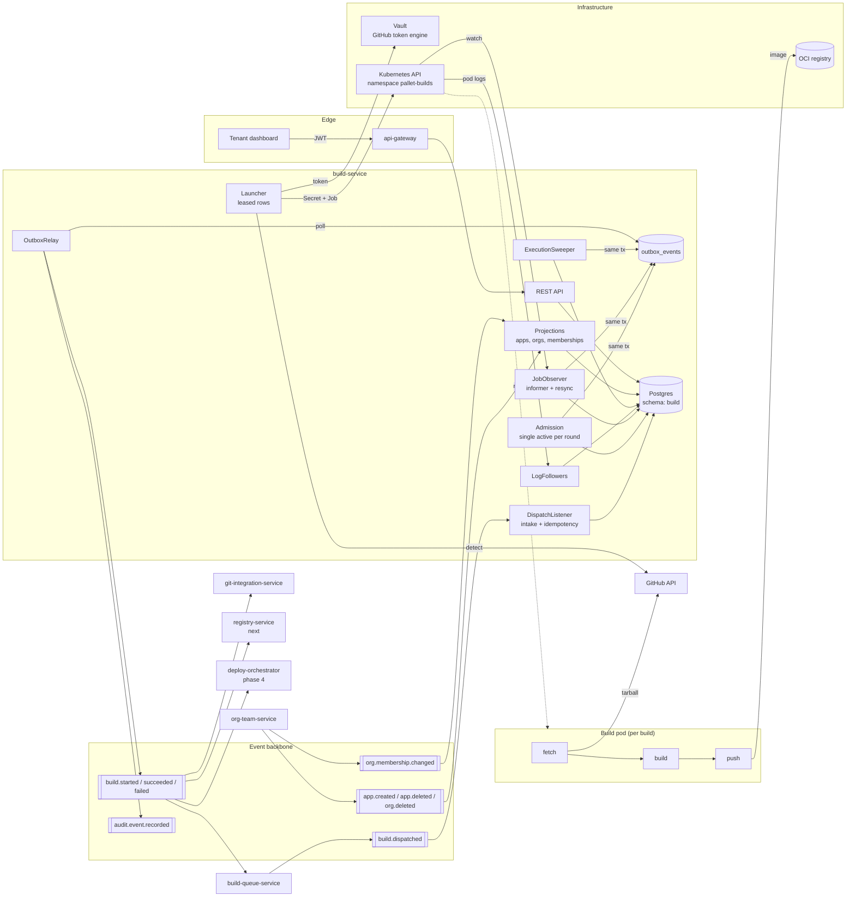
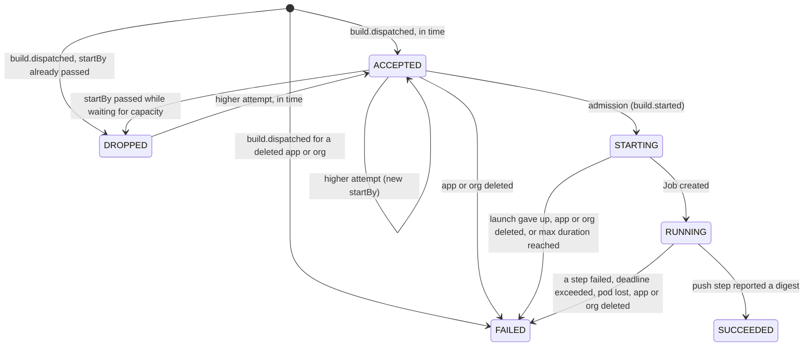
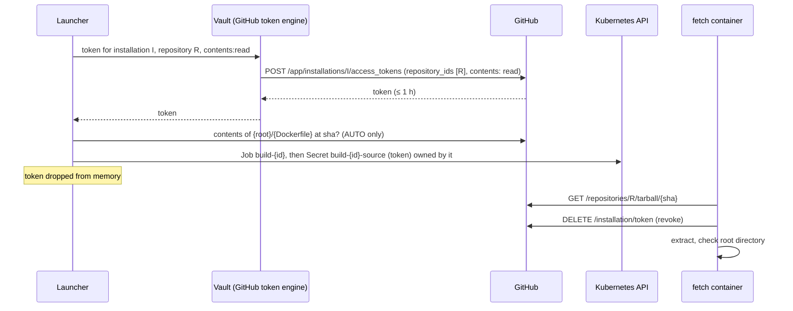
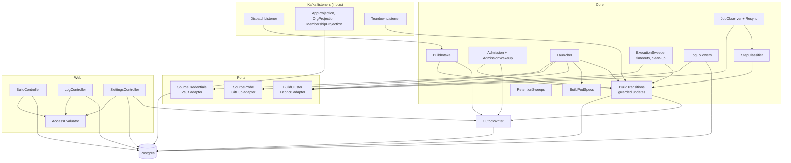

# build-service: Architecture

Status: proposed design, pre-implementation. Third service of `PROJECT.md` Build roadmap phase 3
(the build pipeline), after `git-integration-service` and `build-queue-service`, and before
`registry-service`. Several decisions below change shared contracts or set requirements on other
services. Each one that needs an ADR is listed in
[Decisions that need an ADR](#decisions-that-need-an-adr).

`PROJECT.md` gives this service one paragraph: it "runs the actual build, using Cloud Native
Buildpacks or a Dockerfile, tags the resulting image, and pushes it to the registry. It publishes
`build.started`, `build.succeeded`, and `build.failed` events, and streams build output live for
the tenant-facing logs." Two upstream designs have already set requirements on it:
`build-queue-service` fixed the dispatch contract (§Contract with build-service), and
`git-integration-service` left it the decision on how a build gets credentials for a private
repository (§Source access for the build pipeline). This document is the full design, and it starts
from both.

Read these first, because this document assumes them rather than re-arguing them:
`docs/build-queue-service/ARCHITECTURE.md` §Event contracts, §Leases and deadlines and §Contract
with build-service (what arrives here and what the queue expects back);
`docs/git-integration-service/ARCHITECTURE.md` §Event contracts and §Source access for the build
pipeline; [ADR-0028](../adr/0028-build-dispatch-leases-with-deadlines.md) (the dispatch lease
contract); [ADR-0002](../adr/0002-kubernetes-as-workload-orchestrator.md) and
[ADR-0026](../adr/0026-tenant-runtime-sandboxed-kubernetes-firecracker-deferred.md) (Kubernetes,
and how untrusted code is sandboxed on it); [ADR-0020](../adr/0020-shared-transactional-outbox-and-inbox.md)
and [ADR-0017](../adr/0017-outbox-commit-order-and-relay-lock-timeout.md) (the outbox and inbox);
[ADR-0018](../adr/0018-multi-org-per-account-and-per-request-authorization.md) and
[ADR-0019](../adr/0019-membership-state-topic.md) (authorization against a local membership read
model); [ADR-0013](../adr/0013-per-service-api-path-namespace.md) (the API path); and
[ADR-0009](../adr/0009-temporal-for-saga-orchestration.md) (why this service does not use
Temporal).

## Contents

- [Purpose](#purpose)
- [Position in the system](#position-in-the-system)
- [Design goals and non-goals](#design-goals-and-non-goals)
- [Why a separate build service](#why-a-separate-build-service)
- [Inputs this design must satisfy](#inputs-this-design-must-satisfy)
- [Domain model](#domain-model)
- [Data model](#data-model)
- [Event contracts](#event-contracts)
- [API](#api)
- [Authorization model](#authorization-model)
- [Processing pipelines](#processing-pipelines)
- [The build pod](#the-build-pod)
- [Source access](#source-access)
- [Images and the registry](#images-and-the-registry)
- [Build logs](#build-logs)
- [Deadlines and failure detection](#deadlines-and-failure-detection)
- [Distributed systems mechanisms](#distributed-systems-mechanisms)
- [Consistency and failure modes](#consistency-and-failure-modes)
- [Security and threat model](#security-and-threat-model)
- [Observability and operations](#observability-and-operations)
- [Component view](#component-view)
- [Deployment and scaling view](#deployment-and-scaling-view)
- [Package layout and dependencies](#package-layout-and-dependencies)
- [Configuration](#configuration)
- [Testing approach](#testing-approach)
- [Changes this design needs elsewhere](#changes-this-design-needs-elsewhere)
- [Decisions that need an ADR](#decisions-that-need-an-adr)
- [Extension points](#extension-points)
- [Open questions / deferred](#open-questions--deferred)
- [Relationship to existing planning docs](#relationship-to-existing-planning-docs)

## Purpose

`build-service` turns "build this app at this commit" into an OCI image in a registry. It is the
first Pallet service that runs code it didn't write: every build executes a stranger's Dockerfile
or buildpack scripts. The service:

- Consumes `build.dispatched` and executes each `buildId` at most once, however many times or in
  whatever order the dispatch is delivered.
- Never starts a build after the dispatch's `startBy`, and never lets one run past
  `maxDurationSeconds`.
- Runs each build as a short-lived, sandboxed Kubernetes Job in a namespace that holds nothing
  else, with three steps (fetch, build, push) in separate containers, so the tenant's code never
  shares a container, a mount or an environment with a credential.
- Fetches the exact commit through a GitHub token that Vault mints for that one repository, with
  read access only, and that the fetch step revokes as soon as it is done.
- Builds from a Dockerfile when the app has one, and with Cloud Native Buildpacks when it doesn't.
- Pushes the image to the platform registry under a name that pins it to its org, app, commit and
  build, and reports the digest.
- Publishes `build.started` and then exactly one of `build.succeeded` / `build.failed` for every
  build it starts, through its outbox, with ids that can't change on a retry.
- Captures the build's output and serves it to the tenant while the build runs and after it ends.
- Keeps a build history per app, with each step's timings and a failure classification a developer
  can act on.

It owns three kinds of state: the execution record of each build, the build's log, and each app's
build settings (Dockerfile or buildpacks, and the Dockerfile's path). It doesn't decide which build
runs when (`build-queue-service`), doesn't own image metadata beyond the digest it reports
(`registry-service`), and doesn't deploy anything (`deploy-orchestrator-service`).

## Position in the system



Four kinds of traffic cross this service's boundary:

1. Inbound events: `build.dispatched` (work arriving) and the org, app and membership events that
   feed its read models.
2. Outbound events, all through the transactional outbox: `build.started`, `build.succeeded`,
   `build.failed`, `audit.event.recorded`.
3. Calls to infrastructure and third parties, each through a named `ExternalCall` policy: Vault
   (mint a token), GitHub (detect the build strategy), the Kubernetes API (create and delete
   objects). The long-lived Kubernetes watch and log streams are not request/response calls; their
   failure handling is described in [Deadlines and failure detection](#deadlines-and-failure-detection).
4. Tenant requests through `api-gateway`: build history, a build's detail, its log, and the app's
   build settings.

No synchronous call goes to another Pallet service. The build pod talks to GitHub and to the
registry, never to a Pallet service, and nothing in the cluster talks to the pod.

## Design goals and non-goals

Goals:

- Never run a `buildId` twice. Redelivery, redispatch, a crash between two steps or two instances
  racing must at worst skip a build, never run a second copy of one.
- Never start a build after its `startBy`, and never let one run past `maxDurationSeconds`. These
  are the queue's guarantees as much as this service's (ADR-0028).
- Publish exactly one terminal event for every build that was reported started, even when the
  build pod, the Kubernetes API or this service dies halfway through.
- Keep every credential out of every container that runs tenant code. A tenant's build can be
  hostile; the design assumes it is.
- Give a credential only the reach the one build needs, and only for as long as it needs it: one
  repository, read-only, revoked after the fetch.
- Contain a hostile build: no route to the control plane, the Kubernetes API or the cloud metadata
  endpoint; bounded CPU, memory, disk, time and log volume.
- Never fail a build because this service couldn't see it. An unreachable Kubernetes API delays
  results; it doesn't invent them.
- Tell a developer what failed in terms they can act on: their build, their source, our
  infrastructure, or a limit.
- Bound everything: concurrent builds, time per build, log bytes per build, rows kept after a build
  ends, Kubernetes objects left behind.

Non-goals (this design):

- Scheduling, coalescing or fairness. The queue decided all of that before the dispatch was
  published; this service runs what it's given, in arrival order, up to its capacity.
- Per-app serialization. The queue guarantees one build per app in flight; this service doesn't
  re-enforce it, because a rare overlap after a lease expiry
  (`build-queue-service` §Leases and deadlines) is the queue's to reason about, and blocking here
  would only turn it into a missed start deadline.
- Build-time environment variables and secrets. `secrets-service` (phase 8) owns them. v1 builds
  receive no tenant configuration beyond the strategy and the Dockerfile path.
- A remote layer cache. Every v1 build is cold. A cache needs a registry credential inside the
  build step or a per-app cache volume; both are deferred
  ([Extension points](#extension-points)).
- Image metadata, tag policy, vulnerability scanning and image garbage collection. Those belong to
  `registry-service`.
- Cancelling a running build on request. The queue only cancels builds it hasn't dispatched; a
  `build.cancel.requested` command is an extension both services list.
- Live log streaming over SSE or WebSockets. v1 serves the log by cursor; a live tail is
  `log-service`'s job in phase 6 ([Build logs](#build-logs)).
- Multi-architecture images, Git submodules and Git LFS. v1 builds `linux/amd64` from a source
  tarball.
- Retrying a failed build automatically. A failure is reported; a person or a new push asks again.

## Why a separate build service

Two simpler shapes were considered and rejected.

| Shape | Why not |
|---|---|
| `build-queue-service` creates the build pods itself | The queue holds no credentials and calls no third party, and that is most of why it's easy to reason about. Running builds needs a Vault role, a GitHub call, Kubernetes RBAC, a registry credential and log capture. Putting those into the scheduler gives one service both the tenant-fairness logic and every credential the build path has, and couples the queue's availability to the Kubernetes API's. The dispatch contract (ADR-0028) already lets the two scale and fail separately. |
| A CI system (Tekton, Argo Workflows, kpack, Shipwright) does the work | Each would run the pod, and each brings CRDs, controllers and a status model of its own, with the interesting parts (at-most-once execution, deadlines, credential separation, failure classification) moved into code Pallet doesn't own or learn from. kpack is close to the buildpacks half of this design but has no Dockerfile path and is centred on long-lived `Image` resources rebuilt on change, not one-shot builds keyed by `buildId`. The plain Job API is enough for a single pod with ordered containers. Recorded in ADR-0029's alternatives. |

Temporal isn't used here either. ADR-0009 scopes it to the deploy and billing sagas. A build is one
pod whose containers Kubernetes already runs in order; there is nothing to compensate, and the
state this service keeps (accepted, starting, running, finished) is a short state machine driven
by events and Kubernetes watches, which Postgres rows and a reconciler model directly, the same way
the queue does.

## Inputs this design must satisfy

Recorded by the upstream designs and checked off here, so a reviewer can trace each one to the
section that satisfies it.

| Input | From | Satisfied by |
|---|---|---|
| Use the dispatched `buildId` in every `build.*` event; never mint one | build-queue §Contract 1 | [Dispatch intake](#dispatch-intake); `builds.build_id` is the primary key |
| Execute each `buildId` at most once; a dispatch for a held `buildId` is ignored | build-queue §Contract 2 | [Dispatch intake](#dispatch-intake), the deterministic Job name, and the started-states rule. One refinement: a build that was *dropped before starting* can be accepted by a later attempt ([below](#refinement-to-held)) |
| Never start an attempt after its `startBy` | build-queue §Contract 3 | [Admission](#admission): `build.started` is committed only while `now() < start_by - launch.safety-margin` |
| Stop at `maxDurationSeconds`, report `build.failed` (timeout) | build-queue §Contract 4 | The Job's `activeDeadlineSeconds`, backed by the [execution sweeper](#deadlines-and-failure-detection) |
| Exactly one terminal event per started build, through the outbox, keyed by `orgId` | build-queue §Contract 5 | Guarded transitions, deterministic event ids, outbox ([Event contracts](#event-contracts)) |
| Room for at least `dispatch.global-concurrency` builds | build-queue §Contract 6 | `execution.max-concurrent` and the namespace quota; a misconfiguration shows as `build.accepted_waiting` and an alert ([Observability](#observability-and-operations)) |
| Publish `build.started` promptly once the build is picked up | build-queue §Contract 7 | `build.started` is committed at admission, before the pod exists, in the same transaction that takes the slot |
| `BuildStarted/Succeeded/Failed` carry `appId`, `commitSha` and the originating push event id | git-integration §Event contracts | Already on the records; this design adds fields additively, renames none |
| No credential on any event; source credentials are this service's decision | git-integration §Source access | [Source access](#source-access), ADR-0030 |
| A late result can arrive after a newer build's; deploy only a newer commit | build-queue §Changes elsewhere, item 4 | Passed on to `deploy-orchestrator-service` ([Changes this design needs elsewhere](#changes-this-design-needs-elsewhere)) |

### Refinement to "held"

The queue's contract says a dispatch for a `buildId` this service "already holds" is ignored. Read
literally, a build this service dropped because its `startBy` passed before a slot freed would also
be "held", and attempt 2 of it would be ignored, so the queue's redispatch could never get it built.
The intent of the rule is that a build never *executes* twice. This design keys that on whether the
build was ever reported started:

- A build in a started state (`STARTING`, `RUNNING`, `SUCCEEDED`, `FAILED`) ignores every later
  dispatch, whatever its attempt number.
- A build that hasn't started (`ACCEPTED` waiting for capacity, or `DROPPED` after missing its
  deadline) takes a dispatch with a **higher** attempt number: its attempt and `startBy` are
  replaced and it waits again. A dispatch with the same or a lower attempt is a duplicate and is
  ignored.

This is still at most once, because the only path to a pod is admission, and admission moves a
build into a started state exactly once. The queue's ARCHITECTURE wording is updated to match
([Changes this design needs elsewhere](#changes-this-design-needs-elsewhere), item 3).

## Domain model

One aggregate, `Build`, with its `BuildStep`s and its log, plus `BuildSettings` per app and three
read models.



| Status | Started? | In flight? | Terminal? | Meaning |
|---|---|---|---|---|
| `ACCEPTED` | no | no | no | Dispatch recorded; waiting for a local slot. |
| `DROPPED` | no | no | no | Its `startBy` passed before it could start. Nothing was published. The queue will redispatch or give up; a later attempt can bring it back to `ACCEPTED`. |
| `STARTING` | yes | yes | no | Slot taken and `build.started` committed. The launcher is minting the token, detecting the strategy and creating the Job. |
| `RUNNING` | yes | yes | no | The Job exists in Kubernetes. Its pod may still be pending, fetching, building or pushing; `build_steps` says which. |
| `SUCCEEDED` | yes | no | yes | The image was pushed and its digest recorded. |
| `FAILED` | yes | no | yes | A step failed, a limit was hit, the launch gave up, the pod was lost, or its app or org was deleted. `failure_code` says which. |

`FAILED` straight from intake (a dispatch for an app or org already deleted) is the one terminal
event published for a build that never started. The queue's state machine accepts
`DISPATCHED → FAILED`, and it frees the queue's slot at once instead of burning redispatches on an
app that no longer exists.

Status moves forward only, and every transition is an `UPDATE ... WHERE status IN (allowed
predecessors)` through `BuildTransitions`, acted on by its row count. Two instances observing the
same Job completion both try `RUNNING → SUCCEEDED`; one updates a row and appends the event, the
other updates nothing and appends nothing.

**Steps.** Every build has three: `FETCH` (download the commit, check the root directory), `BUILD`
(the tenant's Dockerfile or buildpacks), `PUSH` (send the image to the registry and report its
digest). Each is `PENDING → RUNNING → SUCCEEDED | FAILED | SKIPPED`, with timestamps and an exit
code, derived from the pod's container statuses. A step is the unit the dashboard shows and the
unit a failure is attributed to.

**Strategy.** `DOCKERFILE` or `BUILDPACKS`, chosen per build from the app's settings:

| Setting | Strategy for the build |
|---|---|
| `AUTO` (default) | `DOCKERFILE` if `{rootDirectory}/{dockerfilePath}` exists at the commit, otherwise `BUILDPACKS`. Decided by the launcher before the pod is created ([Launch](#launch)). |
| `DOCKERFILE` | Always the Dockerfile; a missing file fails the build at `FETCH` with `SOURCE_NOT_FOUND`. |
| `BUILDPACKS` | Always buildpacks, even if a Dockerfile exists. |

The settings are snapshotted onto the build at intake, so changing them while a build waits or runs
changes the next build, not that one.

**Failure codes.** `BuildFailed.reason` stays a short sentence for people. `failureCode` is the
machine-readable classification, chosen from what failed, never from the tenant's output:

| Code | Step | Meaning | Whose problem |
|---|---|---|---|
| `SOURCE_UNAVAILABLE` | launch, `FETCH` | GitHub or the token engine couldn't be reached, or refused the token. Worth rebuilding later. | Platform or GitHub |
| `SOURCE_NOT_FOUND` | `FETCH` | The commit, the repository, the root directory or the configured Dockerfile doesn't exist. | Tenant |
| `DETECTION_FAILED` | `BUILD` | Buildpacks found nothing they know how to build. | Tenant |
| `BUILD_FAILED` | `BUILD` | The tenant's build exited non-zero. | Tenant |
| `RESOURCE_LIMIT` | `BUILD` | The build was OOM-killed or evicted for disk use. | Tenant (or plan) |
| `PUSH_FAILED` | `PUSH` | The registry refused or couldn't be reached. | Platform |
| `TIMEOUT` | any | `maxDurationSeconds` reached. | Tenant (or plan) |
| `LAUNCH_FAILED` | launch | The Job couldn't be created within `launch.max-attempts`. | Platform |
| `INFRASTRUCTURE` | any | The pod was lost: its node died, it was deleted out from under the build, or Kubernetes reported something this service doesn't recognise. | Platform |
| `APP_DELETED`, `ORG_DELETED` | any | The build's app or org went away; a running build was stopped. | Neither |

**Image reference.** `{registry}/{orgId}/{appId}:{commitSha[0..12]}-{buildId[0..8]}`. The tag is
unique per build, so a rebuild of the same commit never overwrites an earlier image, and it reads
as "which commit, which build" at a glance. The digest, not the tag, is the image's identity on
every event.

Read models:

- **`apps`**: `(appId, orgId, status)` from `app.created` / `app.deleted`, order-independent in the
  same way as the queue's (an `app.deleted` for an unknown app inserts it `DELETED`; an `appId` seen
  under a second org is dead-lettered).
- **`orgs`**: `(orgId, status)`, marked `DELETED` on `org.deleted`.
- **`org_memberships`**: from the compacted `org.membership.changed` topic, exactly as
  `git-integration-service` and the queue keep it (ADR-0019).

A dispatch for an app this service hasn't seen yet inserts the app `ACTIVE` under the dispatch's
org, as the queue does for a push: the queue only dispatches for apps it knows, so the app exists
and this projection is just behind.

## Data model

Schema `build`, owned by Flyway. Every timestamp is `timestamptz`, and every deadline is computed
from database `now()`, never an application clock.

```sql
CREATE TABLE apps (
    app_id      text        PRIMARY KEY,
    org_id      text        NOT NULL,
    status      text        NOT NULL CHECK (status IN ('ACTIVE', 'DELETED')),
    deleted_at  timestamptz,
    updated_at  timestamptz NOT NULL DEFAULT now(),
    UNIQUE (org_id, app_id)
);

CREATE TABLE orgs (
    org_id      text        PRIMARY KEY,
    status      text        NOT NULL CHECK (status IN ('ACTIVE', 'DELETED')),
    deleted_at  timestamptz,
    updated_at  timestamptz NOT NULL DEFAULT now()
);

CREATE TABLE org_memberships (
    org_id          text        NOT NULL,
    user_id         text        NOT NULL,
    role            text        NOT NULL CHECK (role IN ('OWNER', 'ADMIN', 'DEVELOPER', 'VIEWER')),
    status          text        NOT NULL CHECK (status IN ('ACTIVE', 'REMOVED')),
    source_version  bigint      NOT NULL,
    updated_at      timestamptz NOT NULL DEFAULT now(),
    PRIMARY KEY (org_id, user_id)
);

CREATE TABLE build_settings (
    org_id           text        NOT NULL,
    app_id           text        NOT NULL,
    strategy         text        NOT NULL DEFAULT 'AUTO'
                                 CHECK (strategy IN ('AUTO', 'DOCKERFILE', 'BUILDPACKS')),
    dockerfile_path  text        NOT NULL DEFAULT 'Dockerfile'
                                 CHECK (length(dockerfile_path) BETWEEN 1 AND 255
                                        AND dockerfile_path !~ '(^/|(^|/)\.\.(/|$))'),
    version          bigint      NOT NULL DEFAULT 0,
    updated_by       text,
    updated_at       timestamptz NOT NULL DEFAULT now(),
    PRIMARY KEY (app_id),
    FOREIGN KEY (org_id, app_id) REFERENCES apps (org_id, app_id) ON DELETE CASCADE
);

CREATE TABLE builds (
    build_id              text        PRIMARY KEY,
    org_id                text        NOT NULL,
    app_id                text        NOT NULL,
    branch                text        NOT NULL,
    commit_sha            text        NOT NULL CHECK (commit_sha ~ '^[0-9a-f]{40}$'),
    push_event_id         uuid        NOT NULL,
    trigger               text        NOT NULL,
    attempt               int         NOT NULL CHECK (attempt >= 1),
    provider              text        NOT NULL,
    installation_id       bigint      NOT NULL,
    repo_id               bigint      NOT NULL,
    repo                  text        NOT NULL,
    root_directory        text        NOT NULL
                                      CHECK (root_directory !~ '(^/|(^|/)\.\.(/|$))'),
    start_by              timestamptz NOT NULL,
    max_duration_seconds  bigint      NOT NULL CHECK (max_duration_seconds > 0),

    strategy_setting      text        NOT NULL CHECK (strategy_setting IN ('AUTO', 'DOCKERFILE', 'BUILDPACKS')),
    dockerfile_path       text        NOT NULL
                                      CHECK (length(dockerfile_path) BETWEEN 1 AND 255
                                             AND dockerfile_path !~ '(^/|(^|/)\.\.(/|$))'),
    strategy              text        CHECK (strategy IN ('DOCKERFILE', 'BUILDPACKS')),

    status                text        NOT NULL CHECK (status IN
                                      ('ACCEPTED', 'DROPPED', 'STARTING', 'RUNNING', 'SUCCEEDED', 'FAILED')),
    failure_code          text        CHECK (failure_code IN
                                      ('SOURCE_UNAVAILABLE', 'SOURCE_NOT_FOUND', 'DETECTION_FAILED', 'BUILD_FAILED',
                                       'RESOURCE_LIMIT', 'PUSH_FAILED', 'TIMEOUT', 'LAUNCH_FAILED', 'INFRASTRUCTURE',
                                       'APP_DELETED', 'ORG_DELETED')),
    failure_reason        text        CHECK (length(failure_reason) <= 512),
    drop_count            int         NOT NULL DEFAULT 0,

    job_name              text        NOT NULL,
    launch_attempts       int         NOT NULL DEFAULT 0,
    launch_last_error     text        CHECK (launch_last_error IN ('SOURCE_UNAVAILABLE', 'LAUNCH_FAILED')),
    next_launch_at        timestamptz,
    launch_claimed_until  timestamptz,
    job_created_at        timestamptz,
    secret_deleted_at     timestamptz,
    cleaned_up_at         timestamptz,

    image_repository      text,
    image_tag             text,
    image_digest          text        CHECK (image_digest ~ '^sha256:[0-9a-f]{64}$'),

    log_bytes             bigint      NOT NULL DEFAULT 0,
    log_truncated         boolean     NOT NULL DEFAULT false,
    log_complete          boolean     NOT NULL DEFAULT false,
    log_owner             text,
    log_lease_until       timestamptz,

    traceparent           text,
    accepted_at           timestamptz NOT NULL DEFAULT now(),
    started_at            timestamptz,
    finished_at           timestamptz,
    updated_at            timestamptz NOT NULL DEFAULT now(),

    FOREIGN KEY (org_id, app_id) REFERENCES apps (org_id, app_id),
    CONSTRAINT ck_builds_started  CHECK (status IN ('ACCEPTED', 'DROPPED') OR started_at IS NOT NULL
                                         OR (status = 'FAILED' AND failure_code IN ('APP_DELETED', 'ORG_DELETED'))),
    CONSTRAINT ck_builds_terminal CHECK ((status IN ('SUCCEEDED', 'FAILED')) = (finished_at IS NOT NULL)),
    CONSTRAINT ck_builds_success  CHECK (status <> 'SUCCEEDED'
                                         OR (image_digest IS NOT NULL AND image_tag IS NOT NULL AND strategy IS NOT NULL)),
    CONSTRAINT ck_builds_failure  CHECK ((status = 'FAILED') = (failure_code IS NOT NULL)),
    CONSTRAINT ck_builds_running  CHECK (status <> 'RUNNING' OR job_created_at IS NOT NULL)
);

-- Admission reads waiting builds oldest first; the launcher reads started builds without a Job.
CREATE INDEX ix_builds_accepted   ON builds (accepted_at) WHERE status = 'ACCEPTED';
CREATE INDEX ix_builds_in_flight  ON builds (status, started_at) WHERE status IN ('STARTING', 'RUNNING');
CREATE INDEX ix_builds_launchable ON builds (next_launch_at) WHERE status = 'STARTING' AND job_created_at IS NULL;
CREATE INDEX ix_builds_cleanup    ON builds (finished_at) WHERE finished_at IS NOT NULL AND cleaned_up_at IS NULL;
CREATE INDEX ix_builds_app        ON builds (org_id, app_id, accepted_at DESC);
CREATE INDEX ix_builds_retention  ON builds (finished_at) WHERE finished_at IS NOT NULL;

CREATE TABLE build_steps (
    build_id     text        NOT NULL REFERENCES builds (build_id) ON DELETE CASCADE,
    step         text        NOT NULL CHECK (step IN ('FETCH', 'BUILD', 'PUSH')),
    status       text        NOT NULL CHECK (status IN ('PENDING', 'RUNNING', 'SUCCEEDED', 'FAILED', 'SKIPPED')),
    exit_code    int,
    started_at   timestamptz,
    finished_at  timestamptz,
    PRIMARY KEY (build_id, step)
);

CREATE TABLE build_log_chunks (
    build_id    text        NOT NULL REFERENCES builds (build_id) ON DELETE CASCADE,
    seq         bigint      NOT NULL CHECK (seq >= 0),
    org_id      text        NOT NULL,
    step        text        NOT NULL CHECK (step IN ('FETCH', 'BUILD', 'PUSH', 'SYSTEM')),
    content     text        NOT NULL,
    created_at  timestamptz NOT NULL DEFAULT now(),
    PRIMARY KEY (build_id, seq)
);

-- One row: when this service last lost sight of the Kubernetes API, and when it last got it back.
CREATE TABLE observer_state (
    id                 boolean     PRIMARY KEY DEFAULT true CHECK (id),
    unreachable_since  timestamptz,
    recovered_at       timestamptz
);
```

Plus `outbox_events` and `processed_events`, copied from `platform-common-outbox`'s reference
schema (ADR-0020).

Notes:

- `build_id` is the primary key, which is what makes at-most-once survive an inbox purge: a
  dispatch whose inbox row is gone still finds the build row.
- `job_name` is `build-{buildId}`, stored rather than recomputed so a later naming change can't
  orphan a running Job. Kubernetes refuses a second Job with the same name, which makes the API
  server a second idempotency fence behind the status machine.
- `ck_builds_started` is what "never ran without being reported started" looks like as a
  constraint: only `ACCEPTED`/`DROPPED`, or a teardown failure straight from intake, can lack a
  `started_at`.
- `build_log_chunks.org_id` is redundant with `builds.org_id` and kept so the tenancy rule (every
  tenant query filters by `orgId`) holds on the log query too.
- `strategy` is null until the launcher decides it; `ck_builds_success` makes a success without one
  impossible.
- `failure_code` is a closed vocabulary, the [failure codes](#domain-model) table. A new code is a
  migration, so nothing can classify a failure with a word no consumer knows.
- The snapshotted `dockerfile_path` carries the same check as `build_settings.dockerfile_path`, so a
  build can't be recorded with a path that escapes its root directory even if intake's validation
  regresses.
- Every constraint is named (`pk_*`, `fk_*`, `ck_*`, `ux_*`) in the migration, so a test can assert
  which one refused a row.

## Event contracts

### Consumed

| Event | Source | Effect here |
|---|---|---|
| `BuildDispatched` | build-queue-service | [Dispatch intake](#dispatch-intake): record, refresh or ignore the build. |
| `AppCreated` | org-team-service | Insert into `apps` if absent. |
| `AppDeleted` | org-team-service | Mark the app `DELETED` (insert it so if unknown); fail its waiting builds and stop its running ones (`APP_DELETED`); delete its settings. |
| `OrgDeleted` | org-team-service | Mark the org `DELETED` and its memberships `REMOVED`; fail or stop every build of the org (`ORG_DELETED`); schedule its logs for deletion. |
| `OrgMembershipChanged` | org-team-service | Upsert the membership if `membershipVersion` is newer (ADR-0019). |

Every listener runs in a transaction whose first statement is the inbox claim, with the usual
exception: the membership listener's idempotency is the version check, so a rebuild can replay the
compacted topic from offset zero.

This service does not consume its own `build.*` events and does not consume `build.cancelled`. A
cancelled build never reaches it (the queue only cancels what it hasn't dispatched), and
`START_TIMEOUT` / `LEASE_EXPIRED` mean the queue stopped waiting, not that the build should stop
([`build-queue-service` §Published](../build-queue-service/ARCHITECTURE.md#published)).

### Published

Every event is appended to the outbox in the same transaction as the state change that produced it
and keyed by `orgId`. Event ids are UUIDv5 over `buildId` and a discriminator (`started`,
`succeeded`, `failed`), in a namespace of this service's own, so a transaction that rolls back and
retries can't publish a second event with a different identity, and the inboxes of the queue and of
`git-integration-service` deduplicate a relay retry.

| Event | Topic | Trigger | Consumers |
|---|---|---|---|
| `BuildStarted` | `build.started` | Admission took a slot for the build | build-queue-service, git-integration-service (check runs); later log-service, deploy-orchestrator-service |
| `BuildSucceeded` | `build.succeeded` | The push step reported a digest | build-queue-service, git-integration-service; registry-service (next); deploy-orchestrator-service (phase 4) |
| `BuildFailed` | `build.failed` | Any failure after start, or a dispatch for a deleted app or org | build-queue-service, git-integration-service; deploy-orchestrator-service, notification-service later |
| `AuditEventRecorded` | `audit.event.recorded` | A person changed an app's build settings | audit-log-service (future) |

The three build records already exist in `platform-common-events` as the minimal contract
`git-integration-service` needed (`buildId`, `appId`, `commitSha`, `pushEventId`, plus `reason` on
a failure). This design extends them additively (ADR-0006); every existing field keeps its name,
type and meaning.

**`BuildStarted`** gains:

| Field | Type | Meaning |
|---|---|---|
| `attempt` | int | The dispatch attempt that started. Lets the queue and operators see when a redispatch was the one that ran. |
| `branch` | string | Passed through from the dispatch. Deploy and notification consumers shouldn't have to join against the queue's events to learn it. |

**`BuildSucceeded`** gains:

| Field | Type | Meaning |
|---|---|---|
| `branch` | string | As above. |
| `strategy` | string | `DOCKERFILE` or `BUILDPACKS`. |
| `imageRepository` | string | `{registry}/{orgId}/{appId}`, without tag or digest. |
| `imageTag` | string | `{commitSha[0..12]}-{buildId[0..8]}`. |
| `imageDigest` | string | `sha256:` and 64 hex characters. The image's identity; deploy pulls by digest. |
| `durationMs` | long | Start to push, from the stored timestamps. |

**`BuildFailed`** gains:

| Field | Type | Meaning |
|---|---|---|
| `branch` | string | As above. |
| `failureCode` | string | One of the [failure codes](#domain-model). Constants on the record. |
| `failedStep` | string | `FETCH`, `BUILD`, `PUSH`, or null when the failure wasn't a step's (launch, teardown). |
| `durationMs` | long | Start to failure, or 0 for a build that never started. |

`reason` keeps its existing meaning: a short sentence a developer can read, at most 256 characters,
written by this service from the failure code and the step's exit status, **never** taken from the
tenant's output. The build's own output is in its log, behind the API's authorization; an event is
readable by every consumer of the topic.

The existing random-id factories (`BuildStarted.of(orgId, buildId, ...)`) stay for source
compatibility and are deprecated. New factories take `eventId` and `occurredAt` from the caller,
as `BuildDispatched.of` does, so the producer can't mint a random id by accident. Removing the
deprecated factories waits until no service's tests use them.

No event carries a token, a registry credential, a log line or an environment variable. A contract
test pins each record's JSON key set, as the queue's does for `BuildDispatched`.

## API

Base path `/api/v1/build` (ADR-0013), routed by `api-gateway`. Every response is `ApiResponse<T>`;
lists are `PageResponse<T>`. `{orgId}` is a path parameter checked against the membership read
model on every request (ADR-0018), never a token claim. A build or app in another org is `404`, not
`403`, as in the other services.

| Method | Path | Role | Behavior |
|---|---|---|---|
| `GET` | `/orgs/{orgId}/apps/{appId}/builds` | VIEWER+ | The app's builds, newest first: `buildId`, `commitSha`, `branch`, `trigger`, `status`, `failureCode`, `strategy`, `imageDigest`, timestamps. Paged. Builds the queue holds but hasn't dispatched aren't here; the dashboard reads those from the queue. |
| `GET` | `/orgs/{orgId}/builds/{buildId}` | VIEWER+ | One build: everything in the list item plus `steps` (status, timing, exit code each), `imageRepository`, `imageTag`, `failureReason`, `attempt`, `log` (`bytes`, `truncated`, `complete`). `404` before this service has seen the dispatch. |
| `GET` | `/orgs/{orgId}/builds/{buildId}/logs?after={seq}&limit={n}` | VIEWER+ | Log chunks with `seq > after`, oldest first, at most `limit` (default 200, max 1000): `chunks[] {seq, step, content}`, `nextAfter`, `complete`, `truncated`. A client tails a running build by polling with the last `nextAfter`. `complete` is true once the build is terminal and its log fully stored. |
| `GET` | `/orgs/{orgId}/apps/{appId}/build-settings` | VIEWER+ | `strategy`, `dockerfilePath`, `version`. Defaults when never set. |
| `PUT` | `/orgs/{orgId}/apps/{appId}/build-settings` | DEVELOPER+ | Replace the settings. Optional `If-Match: {version}` for optimistic concurrency (`409` on mismatch). Validated (`dockerfilePath` relative, inside the root directory, at most 255 characters). Audited. Applies from the next dispatched build. |

The log endpoint is the only one with an unusual cost profile. A dashboard polling it once a second
for a running build would spend its org's whole gateway bucket on one tab
([`api-gateway` §Rate limiting](../api-gateway/ARCHITECTURE.md)). The dashboard therefore polls every
two seconds while a build runs and stops when `complete` is true, and large pages keep the request
count down. If the end-to-end walk shows `429`s, the gateway route gets a per-path limit for
`/logs`, which is a gateway configuration change, not a change here.

Why VIEWER can read logs: a build log is the same information the viewer could get from the
repository and the deployed app, and GitHub shows Actions logs to anyone with read access. If a
tenant prints a secret in a build, that's a leak the tenant made to everyone who can see the build,
on any platform. Tightening it to DEVELOPER+ later is a one-line change in `AccessEvaluator`.

## Authorization model

The same model as `git-integration-service` and the queue, with no service-specific twist:

- The token supplies `sub` and nothing else this service decides on.
- `AccessResolver` reads the caller's membership for `{orgId}` from `org_memberships`, joined with
  `orgs`: a `DELETED` org or no membership row is `404 ORG_NOT_FOUND` (the same response either
  way), a `REMOVED` row is `403 NOT_A_MEMBER`, an `ACTIVE` row yields the caller's role.
- `ResourceScope` checks that the build or app in the path belongs to `{orgId}`; if it doesn't, the
  answer is `404`, identical to the answer for an id that doesn't exist. A deleted app's builds stay
  readable until retention removes them.
- `AccessEvaluator` maps each endpoint to its minimum role (the table above); below it is
  `403 INSUFFICIENT_ROLE`.
- Session revocation (ADR-0015) through the shared Redis-backed `RevokedSessionRegistry`.

**Rebuilding the membership read model.** The membership listener runs in its own consumer group
(`build-service.membership-state`) with no inbox, so the table can be rebuilt from the compacted
topic alone: stop that consumer group, `TRUNCATE build.org_memberships`, reset the group's offsets
for `org.membership.changed` to earliest, and start it again. The version check makes the replay
converge on the latest record of every membership. `apps` and `orgs` are never rebuilt this way:
they hold tombstones that no topic can reproduce, and builds reference them.

### Error catalog

Every error is an `AppException` rendered by `GlobalExceptionHandler`.

| Code | Status | When |
|---|---|---|
| `ORG_NOT_FOUND` | 404 | The org doesn't exist, was deleted, or the caller has no membership row in it. |
| `NOT_A_MEMBER` | 403 | The caller's membership was removed. |
| `INSUFFICIENT_ROLE` | 403 | The caller's role is below the endpoint's floor. |
| `APP_NOT_FOUND` | 404 | The app isn't in this org. |
| `BUILD_NOT_FOUND` | 404 | The build isn't in this org, or this service hasn't seen its dispatch yet. |
| `APP_DELETED` | 409 | Changing the build settings of a deleted app. |
| `SETTINGS_VERSION_CONFLICT` | 409 | `If-Match` doesn't match the settings' current version. |
| `INVALID_BUILD_SETTINGS` | 400 | A `dockerfilePath` that's absolute, contains a `..` segment, or is too long; an unknown strategy. |
| `INVALID_LOG_CURSOR` | 400 | `after` negative, `limit` out of range. |

## Processing pipelines

```mermaid
sequenceDiagram
    participant K as Kafka
    participant D as DispatchListener
    participant DB as Postgres
    participant A as Admission
    participant L as Launcher
    participant V as Vault
    participant GH as GitHub
    participant KA as Kubernetes API
    participant O as JobObserver

    K->>D: build.dispatched(buildId, attempt, startBy)
    D->>DB: inbox claim; insert / refresh / ignore build (ACCEPTED)
    A->>DB: advisory lock; in-flight < capacity and now() < startBy - margin
    A->>DB: ACCEPTED → STARTING, outbox build.started
    L->>DB: lease STARTING row without a Job
    L->>V: mint token (repo-scoped, contents:read)
    L->>GH: Dockerfile exists at commit? (AUTO only)
    L->>KA: create Job build-{id}, then Secret build-{id}-source owned by it
    L->>DB: STARTING → RUNNING, strategy, job_created_at
    KA-->>O: pod / container status changes
    O->>DB: steps; on completion RUNNING → SUCCEEDED/FAILED, outbox build.*
```

### Dispatch intake

`DispatchListener` consumes `build.dispatched`. In one transaction, inbox claim first:

1. Validate: every field present, `buildId` a lowercase UUID (it names the build's Kubernetes
   objects), `commitSha` 40 lowercase hex, `rootDirectory` relative without `..`,
   `maxDurationSeconds` positive and at most `execution.max-duration-cap`, `provider` is `GITHUB`,
   and the record keyed by its `orgId`. A missing, empty or `.` `rootDirectory` is the repository
   root, stored as `""`. A malformed dispatch is dead-lettered and alerted on; it can't be retried
   into validity.
2. Check the app against `apps`: an `appId` registered under a different org is a poison message
   (dead-lettered, never applied). An unknown app is inserted `ACTIVE` under the dispatch's org.
   The org and app rows are then share-locked, so an `app.deleted` or `org.deleted` committing at
   the same moment is either seen here or waits until this build is recorded and can tear it down.
3. If the app or org is `DELETED`: insert the build directly as `FAILED` (`APP_DELETED` /
   `ORG_DELETED`), publish `build.failed`, done. If the build row already exists, do nothing.
4. Otherwise, against any existing row for `buildId` (locked `FOR UPDATE`):
   - **No row**: insert `ACCEPTED` if `start_by > now() + launch.safety-margin`, otherwise insert
     `DROPPED` (counted `late`). Snapshot the app's build settings onto the row.
   - **Row in `ACCEPTED` or `DROPPED` with a lower attempt**: replace `attempt` and `start_by`, set
     `ACCEPTED` if in time and count `reaccepted`; otherwise stay or become `DROPPED`
     (`drop_count + 1`) and count `late`. The settings snapshot is not refreshed.
   - **Row with the same or a higher attempt, or in a started state**: ignore, count `duplicate`.
   - A row whose `org_id`, `app_id` or `commit_sha` differs from the dispatch: poison, dead-letter.
     The queue derives `buildId` from the push, so this can't happen without a bug or a forgery.
5. `pg_notify('build_admission', '')` if a row became `ACCEPTED`, so admission runs at once.

The dispatch's `traceparent` header is stored on the row and carried on every outbox row the build
produces later.

### Admission

The only place a build becomes "started". Runs single-active per round through
`pg_try_advisory_xact_lock(AdmissionLock)`, woken by `LISTEN build_admission` and by the in-flight
count dropping, with `admission.poll-interval` as the safety net:

1. Count in-flight builds (`STARTING`, `RUNNING`). If `>= execution.max-concurrent`, stop.
2. `ACCEPTED` rows whose `start_by <= now() + launch.safety-margin` → `DROPPED`, `drop_count + 1`,
   counted `dropped{reason=start_deadline}`. Nothing is published: the queue redispatches.
3. Take up to `capacity - in_flight` `ACCEPTED` rows, oldest `accepted_at` first, `FOR UPDATE SKIP
   LOCKED`, and for each: `ACCEPTED → STARTING`, `started_at = now()`, `next_launch_at = now()`,
   three `build_steps` rows `PENDING`, and `BuildStarted` appended to the outbox, all in this one
   transaction.

`launch.safety-margin` (default 10 s) covers the relay's delay between commit and publish, so the
queue receives `build.started` before the `startBy` it set, not just after it.

Admission is the only writer of `STARTING`. That one rule, plus `build_id` as the primary key, is
the whole at-most-once argument: whatever happens to dispatches, there is one row per build and one
transition into a started state.

### Launch

`Launcher` turns `STARTING` rows into Kubernetes objects. Several instances can launch at once: each
leases rows (`launch_claimed_until = now() + launch.claim-ttl`) with `FOR UPDATE SKIP LOCKED` in a
short transaction, then does the slow work with nothing held:

1. **Credentials**: `SourceCredentials.mint(installationId, repoId)` through the `vault` policy
   ([Source access](#source-access)). The token stays in memory only.
2. **Strategy**: if the snapshot says `AUTO`, `SourceProbe.dockerfileExists(repoId, commitSha,
   rootDirectory, dockerfilePath, token)` through the `github-source` policy (one contents API
   call). Otherwise use the snapshot.
3. **Objects**: through the `kubernetes` policy, create the Job `build-{buildId}` from
   `BuildPodSpecs` for the strategy ([The build pod](#the-build-pod)), then the Secret
   `build-{buildId}-source` (the token, as a file) with an owner reference to the Job's UID, so
   Kubernetes garbage-collects it with the Job. The pod can't start its `fetch` container until the
   Secret exists (the kubelet retries the volume mount), so creating the Job first costs nothing,
   and setting the owner at creation means this service never needs `update` or `patch` on
   Secrets. `activeDeadlineSeconds` is the build's remaining time: `max_duration_seconds - (now() -
   started_at)`, so a slow launch never extends a build.
4. **Record**: in a new transaction, `STARTING → RUNNING`, `strategy`, `job_created_at = now()`.

`409 AlreadyExists` on the Job means an earlier launch of this build got further than its database
write (a crash, or a lost response). The launcher adopts the existing Job if its
`pallet.io/build-id` label matches, and records `RUNNING`; a Job with that name and another build id
is impossible and alerted on. A `409` on the Secret means an earlier launch created it with a token
that may already be expired: the launcher deletes it and creates it again with the fresh token.

On failure the lease is released with `next_launch_at` backed off exponentially. A
`SOURCE_UNAVAILABLE` cause (Vault or GitHub) and a Kubernetes failure are retried the same way,
until `launch.max-attempts` or until `started_at + launch.deadline` passes, whichever comes first;
then `STARTING → FAILED` with `build.failed`, the failure code taken from `launch_last_error`
(`SOURCE_UNAVAILABLE` if Vault or GitHub caused the last failure, `LAUNCH_FAILED` if Kubernetes
did), and any object that was created is deleted. The probe runs only for `AUTO`; an explicit
`DOCKERFILE` setting whose file is missing is caught by the `fetch` step (`SOURCE_NOT_FOUND`), so the
launcher never fails a build for a reason a retry can't fix.

### Observation

`JobObserver` keeps a Fabric8 informer on Jobs and Pods in the builds namespace, filtered by the
label `app.kubernetes.io/managed-by=pallet-build-service`. Every instance runs one; every update is
a guarded transition, so it doesn't matter which instance handles a change, or whether two do.

On a pod change it maps container statuses to steps:

| Container state | Step change |
|---|---|
| `fetch` running / terminated | `FETCH` `RUNNING` / `SUCCEEDED` or `FAILED` with exit code |
| `build` (or the buildpacks containers) running / terminated | `BUILD` likewise |
| `push` (or `export`, `report`) running / terminated | `PUSH` likewise |
| `fetch` terminated | Delete the source Secret (`secret_deleted_at`); the token is already revoked by the fetch step, this removes the object too. |

On a Job condition it completes the build, in one transaction:

| Job / pod outcome | Transition |
|---|---|
| `Complete`, and the `push`/`report` container's termination message has a valid digest | `RUNNING → SUCCEEDED`, image fields set, steps closed, `BuildSucceeded` |
| `Failed`, reason `DeadlineExceeded` | `FAILED` (`TIMEOUT`), the running step `FAILED`, later steps `SKIPPED` |
| `Failed`, a step's container terminated non-zero | `FAILED` with the code mapped from the step and its exit code ([The build pod](#exit-codes)) |
| `Failed`, a container `OOMKilled`, or the pod evicted for ephemeral storage | `FAILED` (`RESOURCE_LIMIT`) |
| `Complete` but no parsable digest | `FAILED` (`PUSH_FAILED`), and `build.anomaly` counted |
| Anything else (node lost, pod deleted, unknown reason) | `FAILED` (`INFRASTRUCTURE`) |

Termination messages are read only from the containers Pallet controls (`fetch`, `push`, `report`),
parsed as a small JSON document with a fixed schema, and ignored if they don't parse. The `build`
container's termination message is never read: it's tenant-controlled.

An informer can miss changes while its watch reconnects, so a **resync** every
`observer.resync-interval` lists the Jobs for every `RUNNING` build and applies the same mapping.
The resync is also how a build whose Job vanished is noticed: a `RUNNING` build with no Job, on a
list that succeeded, past `observer.missing-grace`, becomes `FAILED` (`INFRASTRUCTURE`).

### Completion and clean-up

After a terminal transition, the `ExecutionSweeper`'s clean-up pass deletes the Job with
`propagationPolicy: Background` (taking its pod and, through the owner reference, its Secret with
it) once the build's log is complete, then deletes the source Secret by name as well, tolerating
`404`, and sets `cleaned_up_at`. The delete by name is belt and braces for a Secret whose owner
reference never took effect: this service has no right to list Secrets, so it finds them by the
deterministic name, never by search. `ttlSecondsAfterFinished` on the Job is the backstop if this
service never gets to it. Deleting promptly matters because a finished pod still holds its node's
ephemeral storage and its log until it's gone, and because nothing about a finished build needs to
stay in the cluster: its outcome, steps and log are in Postgres.

### Teardown

`app.deleted` and `org.deleted` move every non-terminal build of the app or org to `FAILED`
(`APP_DELETED` / `ORG_DELETED`):

- `ACCEPTED` / `DROPPED`: straight to `FAILED`, `build.failed` published (the queue's slot is freed
  at once; for `DROPPED` the queue may already have given up, and the event is then recorded as a
  late result).
- `STARTING` / `RUNNING`: `FAILED` with `build.failed`, and the Job deleted by the clean-up pass.
  The push may already have happened; the image is then left for `registry-service` to collect with
  the rest of the app's images.

The teardown also deletes the app's `build_settings` row. The foreign key's cascade doesn't do it,
because `apps` rows are tombstoned on `app.deleted`, not deleted; the cascade only fires when
retention finally removes the tombstone. For `org.deleted`, the org's logs are deleted by the next
retention run regardless of age.

## The build pod

One Job per build, `backoffLimit: 0`, `restartPolicy: Never`, in the namespace
`execution.namespace` (`pallet-builds`), which holds only build pods, their Secrets and the
platform's registry push credential. Each strategy is a fixed sequence of init containers followed
by one main container. Init containers run one at a time, in order, and the next starts only if the
previous exited 0, which is exactly the step order a build needs.

### Containers

**`DOCKERFILE`:**

| Container | Image | Runs | Credential | Tenant code? |
|---|---|---|---|---|
| `fetch` (init) | `build-steps` (Pallet) | Download the commit tarball by repository id, extract under `/workspace/src`, check `rootDirectory` and the Dockerfile exist, revoke the token | GitHub token (Secret file) | no |
| `build` (init) | BuildKit, rootless, daemonless | Build `/workspace/src/{rootDirectory}` with `{dockerfilePath}`; write the image as an OCI archive to `/workspace/out/image.tar` | none | **yes** |
| `push` (main) | `build-steps` (Pallet) | Push the OCI archive to the image reference; write `{digest, strategy}` as the termination message | registry push credential | no |

**`BUILDPACKS`**, following the CNB platform flow for untrusted builders, where the lifecycle
phases that touch a registry run from the trusted lifecycle image and the phases that run buildpack
code run in the builder image with no credentials:

| Container | Image | Runs | Credential | Tenant code? |
|---|---|---|---|---|
| `fetch` (init) | `build-steps` | As above, without the Dockerfile check | GitHub token | no |
| `analyze` (init) | CNB lifecycle | Resolve the run image; check the output repository is writable | registry push credential (the lifecycle refuses to start without access to the output image) | no |
| `detect` (init) | Builder | Choose buildpacks for the app | none | **yes** |
| `build` (init) | Builder | Run the buildpacks | none | **yes** |
| `export` (init) | CNB lifecycle | Assemble the image from the build's layers and push it; write a report with the digest | registry push credential | no (reads tenant-produced files) |
| `report` (main) | `build-steps` | Turn the lifecycle's report into the termination message | none | no |

Step mapping: `fetch` is `FETCH`; `analyze`, `detect`, `build` are `BUILD`; `export`, `report`, `push`
are `PUSH`.

The exact image versions, lifecycle platform API version and flags are pinned by digest in
configuration and proven by hand in the sandbox spike checkpoint before any controller code exists.
If the phased lifecycle can't be made to work under the sandbox, the recorded fallback is the
lifecycle's OCI-layout export followed by the same `push` container the Dockerfile path uses; the
property that matters, no credential in a container that runs buildpack code, is the same either
way.

Why rootless BuildKit for Dockerfiles: it's the engine behind `docker build`, so a tenant's
Dockerfile behaves as it does on their laptop; it runs without a daemon and without root; and it can
write an OCI archive instead of pushing, which is what lets the push live in a different container.
Kaniko, the usual alternative, was archived upstream in 2025. Buildah with chroot isolation is the
recorded fallback if BuildKit can't run under the deployed sandbox. ADR-0029 records the comparison.

### Why the credential separation holds

- A container sees only the volumes mounted into it. The source Secret is mounted only into
  `fetch`; the registry credential only into `push`, `analyze` and `export`, which run Pallet's or
  the trusted lifecycle's code. The `build` container has neither,
  and nothing it does can change its own mounts.
- The containers run one after another. By the time tenant code runs, `fetch` has exited and
  revoked its token at GitHub, and `analyze` has exited with its registry credential. By the time a credential is present again, tenant code has exited.
- `shareProcessNamespace` is off, so no container can see another's processes or their
  environment.
- `push` and `export` read files the tenant produced (the archive, the layers) but execute nothing
  from them. Their parsers are the remaining attack surface, which is why the registry credential's
  reach is narrowed by `registry-service` next
  ([Images and the registry](#images-and-the-registry)).

### Pod spec

Fixed by `BuildPodSpecs` and pinned by a snapshot test. Configuration chooses images, resources and
the runtime class; nothing a tenant controls reaches the spec except the build's own source,
`rootDirectory` and `dockerfilePath`, which are validated and passed as arguments, never through a
shell.

- `serviceAccountName: pallet-build`, a service account with no RoleBindings;
  `automountServiceAccountToken: false`; `enableServiceLinks: false` (no environment variables
  about the cluster's services).
- `runtimeClassName` from `execution.runtime-class` (gVisor in deployed clusters, per ADR-0026;
  unset on the local `kind` cluster, which has no sandboxed runtime).
- No `hostNetwork`, `hostPID`, `hostIPC`, `hostPath`, or privileged container. Pallet's own
  containers run as non-root with a read-only root filesystem and every capability dropped. The
  BuildKit container creates its own user namespace as a non-root user (1000), which needs
  unconfined seccomp and AppArmor profiles, privilege escalation allowed, and `SETUID` and `SETGID`
  kept when every other capability is dropped (`newuidmap` and `newgidmap` rely on file
  capabilities); its root filesystem stays read-only, and BuildKit's `noProcessSandbox` comes from
  the namespace's `pallet-buildkitd-config` ConfigMap rather than an environment variable. That
  relaxation is what the gVisor sandbox exists to make acceptable, and it's the one exception the
  namespace's admission policy allows, for that container name and image only.
- `fsGroup` is the user of the container that runs tenant code (1000 for BuildKit, the builder's
  CNB group 1001 for buildpacks), and `fetch` leaves the source group-writable, because buildpacks
  write into the app directory. The builder containers carry one environment variable,
  `CNB_PLATFORM_API`, since the lifecycle has no flag for it.
- Volumes: `workspace` (`emptyDir`, size-limited), `source-token` (the Secret, `fetch` only),
  `registry-auth` (the platform push Secret, `push`, `analyze` and `export` only), `tmp` (`emptyDir`
  per container that needs one), and BuildKit's state and runtime directories. Locally, where
  Pallet's step image lives in the authenticated local registry, the pod also lists the push Secret
  under `imagePullSecrets`; only the kubelet reads it.
- Resources per strategy from configuration: requests and limits for CPU and memory on the build
  container, small fixed ones on Pallet's containers, and a pod-level `ephemeral-storage` limit.
- `activeDeadlineSeconds` as computed at launch; `ttlSecondsAfterFinished` as the clean-up backstop.
- Labels: `app.kubernetes.io/managed-by=pallet-build-service`, `pallet.io/build-id`,
  `pallet.io/app-id`, `pallet.io/org-id`. Annotations: the `traceparent`.

### Exit codes

Pallet's step scripts report through exit codes and a JSON termination message; the tenant's build
reports only through its exit code and its Kubernetes termination reason.

| Container | Exit code | Failure code |
|---|---|---|
| `fetch` | 10 | `SOURCE_UNAVAILABLE` (network, 5xx, 401/403 from GitHub) |
| `fetch` | 11 | `SOURCE_NOT_FOUND` (404 for the commit or repository; root directory or Dockerfile missing) |
| `detect` | non-zero | `DETECTION_FAILED` |
| `build` | non-zero | `BUILD_FAILED` (`RESOURCE_LIMIT` if `OOMKilled`) |
| `push`, `export`, `report` | non-zero | `PUSH_FAILED` |
| any | killed by the deadline | `TIMEOUT` |

### Isolation outside the pod

Applied to the namespace by the platform's own manifests (`deploy/local/k8s/builds/` locally), not
by this service at runtime:

- **NetworkPolicy**: default deny ingress; egress allowed to DNS, to the registry, and to the public
  internet, and denied to the cluster's pod and service ranges, the Kubernetes API, the node
  network and the cloud metadata address. Builds need the internet for dependencies; they never
  need anything inside the cluster except the registry.
- **ResourceQuota**: a hard ceiling on pods, CPU, memory and ephemeral storage in the namespace, set
  a little above `execution.max-concurrent` builds, so a bug in admission can't flood the cluster.
- **LimitRange**: defaults for any container that somehow lacks limits.
- **ValidatingAdmissionPolicy** on the namespace: every pod must use the `pallet-build` service
  account with token automount off; no host namespaces, `hostPath` or privileged containers; the
  runtime class must be set where the cluster has one; the BuildKit relaxations (unconfined
  seccomp and AppArmor, privilege escalation, `SETUID`/`SETGID`) only on a container named `build`
  running the configured BuildKit image; the registry Secret mounted only into `push`, `analyze`
  and `export`. Even a compromised `build-service`
  can't create a pod there that breaks out of these rules.
- **RBAC for `build-service`**: a namespaced Role allowing `create`, `get`, `list`, `watch`,
  `delete` on Jobs; `get`, `list`, `watch` on Pods and `get` on `pods/log`; and only `create` and
  `delete` on Secrets. No `get` or `list` on Secrets: the service can write a build's
  token but can't read the registry credential or any other Secret. Nothing cluster-scoped.

Locally, `kind`'s default network plugin doesn't enforce NetworkPolicy. The hardening checkpoint
adds a Calico-enabled variant of the local cluster for verifying the policy; the everyday local
cluster stays as it is.

### Where builds run

v1 runs every build on one cluster, the one `execution.kubeconfig` (or the in-cluster config) points
at: the local `kind` cluster in development, a dedicated build node pool beside the control plane
when deployed. Builds don't run on the tenant runtime clusters that `scheduler-service` registers:
build load is bursty and CPU-heavy, and keeping it off the clusters that serve tenant traffic keeps
one tenant's build from slowing another tenant's app. A separate build cluster per cloud is an
extension, and it would need the same kind of cluster registry `scheduler-service` keeps.

## Source access

ADR-0030 records this decision, made here because `git-integration-service` left it to this
service. The options and why the others were rejected are in
[`git-integration-service` §Source access](../git-integration-service/ARCHITECTURE.md#source-access-for-the-build-pipeline);
this section is how the chosen one works.



- **The App private key lives in Vault**, configured into a GitHub token secrets engine (a Vault
  plugin that mints installation tokens). The engine signs the App JWT and calls GitHub; the key
  never leaves Vault, and `build-service` never sees it.
- **`build-service`'s Vault policy allows one thing**: requesting a token with `contents: read`
  scoped to the repository ids in the request. Vault ACL parameter constraints enforce the
  permission set, so a compromised `build-service` can read any repository the App can read, but
  can't write to one, can't create a check run, and can't mint a broader token. The exact plugin
  paths and policy are pinned in the source-credentials checkpoint.
- **Auth to Vault**: the Kubernetes auth method in a deployed cluster (the pod's service account
  token); a token from a git-ignored file locally. Calls go through the `vault` `ExternalCall`
  policy: Vault is infrastructure Pallet runs, but a slow Vault must not stall the launcher, and its
  breaker state is worth seeing.
- **The token's life**: minted immediately before the Job is created, held in memory only, written
  into one Secret mounted into one container, used for two GitHub calls (the probe in the service,
  the tarball in the pod), and revoked by the `fetch` step the moment the download ends, success or
  not (a shell `trap`). GitHub's one-hour expiry is the backstop. It's never logged, never stored in
  Postgres, never on an event, never in an environment variable.
- **By repository id, not name**: the tarball is fetched from
  `/repositories/{repoId}/tarball/{sha}`, so a renamed or transferred repository still resolves to
  the one the link named, and a repository created later under the old name can't be fetched in
  its place.
- **Extraction**: into an `emptyDir`, stripping the archive's top-level directory, without
  preserving owners or permissions, refusing absolute paths and `..` entries, and refusing symlinks
  that resolve outside the workspace when checking `rootDirectory`.

**Local development without Vault**: `source.credentials: anonymous` skips minting; the probe and
the fetch call GitHub without a token, so only public repositories build, under GitHub's
unauthenticated rate limit. This is the default until a developer sets up the local Vault plugin,
and the service logs a warning at startup while it's on. `vault` is the only mode a deployed
profile accepts.

## Images and the registry

- **Registry**: an OCI distribution registry the platform runs. Locally, a `registry` container in
  the `core` profile, attached to both the compose network and the `kind` network so build pods,
  the kind nodes and developers can all reach it, wired into the kind nodes' containerd by the
  bootstrap script. When deployed, the registry `registry-service`'s design picks (Harbor is
  `PROJECT.md`'s example).
- **Naming**: `{registry}/{orgId}/{appId}:{commitSha[0..12]}-{buildId[0..8]}`. Org and app ids are
  lowercase and registry-safe; `BuildPodSpecs` refuses to build a reference that isn't, which would
  mean an id format changed upstream.
- **Push credential (v1)**: one platform credential with push rights, stored in the builds
  namespace as a Secret that `build-service` references by name but can't read, mounted only into
  `push`, `analyze` and `export`. Locally, an htpasswd user on the registry, which authenticates
  pulls as well as pushes, so anything running an image from it needs an image pull Secret.
- **What this doesn't stop**: a hostile image archive that exploited the push tool could use the
  platform credential to push into another tenant's repository. The tag scheme means it couldn't
  overwrite a tag a build already produced without the attempt being visible, and deploy pulls by
  digest, but it's a real gap. Closing it means a credential per build that can push only to
  `{orgId}/{appId}` and expires with the build, which is a registry feature (token auth or robot
  accounts) and so `registry-service`'s design. It's the first item of
  [Changes this design needs elsewhere](#changes-this-design-needs-elsewhere) for that service.
- **Pulling base images**: Dockerfile `FROM` lines and the buildpacks run image come from public
  registries, anonymously. Docker Hub's anonymous pull limit applies per node; a pull-through cache
  is an extension.

`build-service` reports the digest and the reference; it doesn't record image metadata, tag
policy or size. `registry-service` consumes `build.succeeded` for that.

## Build logs

ADR-0031 records this, because it gives `build-service` a job `PROJECT.md` assigns to `log-service`
in the long run.

`PROJECT.md` says this service "streams build output live for the tenant-facing logs", and
`log-service` (phase 6) is the platform's log store with a live tail. Phase 3's exit criterion
needs a developer to see why a build failed now, three phases before `log-service` exists. So in v1
this service captures and serves build logs itself, in a shape `log-service` can take over:

- **Capture**: one `LogFollower` per running build streams `pods/log?follow=true` for each container
  in step order, and appends chunks (up to `logs.chunk-bytes`, or whatever arrived within
  `logs.flush-interval`) to `build_log_chunks` with a per-build `seq`. Lines are prefixed with
  nothing; the chunk's `step` says where they came from. `SYSTEM` chunks record what Pallet did
  ("Fetching abc1234 from owner/repo", "Building with buildpacks", "Pushed sha256:...").
- **Ownership**: each running build has one follower at a time, held by a row lease
  (`log_owner`, `log_lease_until`) renewed while it streams. If an instance dies, another takes the
  lease after it expires and resumes: it reads the container's log from the beginning and skips the
  bytes already stored, which works because a container's log doesn't change once written and the
  per-build cap is below the kubelet's rotation size.
- **Bounds**: at most `logs.max-bytes` per build (default 5 MiB). Past it, one `SYSTEM` chunk says
  the log was truncated, `log_truncated` is set, and the rest is discarded; the build carries on. A
  build that prints without end costs the platform 5 MiB, not a disk.
- **Completion**: once the build is terminal and every container's stream has ended, `log_complete`
  is set; the Job is deleted only after that (or after `logs.complete-timeout`, so a stuck stream
  can't keep a pod forever).
- **Serving**: the cursor endpoint in [API](#api). Content is returned as stored, as JSON strings;
  the dashboard renders it as text and must not interpret it as HTML. ANSI colour codes are left in
  for the dashboard to render or strip.
- **What's never in a build log**: the source token (the `fetch` script never echoes it, runs with
  tracing off and passes it to `curl` from a file), the registry credential, or anything from
  Pallet's own service logs.

When `log-service` arrives, build logs move there: `build-service` either publishes chunks as events
or a cluster log collector picks the build pods up like any other container, and this service's
log table and endpoint are retired with a deprecation window. Until then they're bounded by
retention like everything else.

Platform logs (this service's own) never contain a build log line, a commit message, a token, or a
Dockerfile path, at any level. They carry `buildId`, `orgId`, `appId`, step and outcome.

## Deadlines and failure detection

The queue's lease protects the queue's slot. This service has its own deadlines to protect the
contract's two promises, never start late and never run long:

| Deadline | Enforced by | When it passes |
|---|---|---|
| `start_by - launch.safety-margin` | Admission | An `ACCEPTED` build becomes `DROPPED`. Nothing published. |
| `started_at + launch.deadline` | Launcher | A `STARTING` build whose Job couldn't be created becomes `FAILED` (`LAUNCH_FAILED` or `SOURCE_UNAVAILABLE`). |
| `started_at + max_duration_seconds` | Kubernetes (`activeDeadlineSeconds`), with the `ExecutionSweeper` as backstop | The Job is killed; `FAILED` (`TIMEOUT`). If the API hasn't reported it within `observer.deadline-grace`, the sweeper deletes the Job and records the timeout itself. |
| No Job for a `RUNNING` build for `observer.missing-grace` | Resync | `FAILED` (`INFRASTRUCTURE`). |
| `finished_at + logs.complete-timeout` | Clean-up | The log is marked complete as it stands and the Job deleted. |

Every one of these is measured from database `now()` against stored timestamps.

**Not mistaking blindness for failure.** The same rule the queue applies to Kafka applies here to
the Kubernetes API. If the API server can't be reached, the informer's watch is down, and a list
fails, then a build with no visible Job may be perfectly healthy. While the observer can't reach
the API:

- the missing-Job check and the sweeper's timeout backstop don't act (Kubernetes itself still
  enforces `activeDeadlineSeconds` on its side);
- `observer_state.unreachable_since` is set, `build.kube.reachable` is 0, and an alert fires after a
  few minutes;
- admission keeps admitting up to capacity (builds will launch when the API returns, or fail by
  `launch.deadline`), and the launcher's `kubernetes` breaker keeps it from hammering the API.

When the API returns, a full resync runs before any missing-Job check, and the missing-Job grace is
counted from the recovery, not from the outage, so builds that finished during the outage are
recorded as their Jobs report them, not failed as lost. The queue sees these results as normal or
late results; its own lease may have expired in the meantime, which it records and survives.

## Distributed systems mechanisms

| Concern | Mechanism | Where |
|---|---|---|
| Atomic state change and event | Transactional outbox, commit-order relay (ADR-0017, ADR-0020) | Every transition |
| Effectively-once consumption | Transactional inbox; `build_id` primary key as the second guard | Every listener |
| At-most-once execution | One writer of the started state (admission); deterministic Job name refused twice by the API server; started builds ignore every later dispatch | Admission, Launcher |
| Never start late | `build.started` committed only before `startBy - margin`; late or waiting builds dropped, not started | Admission |
| Intent before side effect | `STARTING` and `build.started` commit before the Job exists; the launcher reconciles the world to the row, and gives up with a terminal event | Admission, Launcher |
| Idempotent side effects | Create-or-adopt on `409`; labels checked on adoption; deletes tolerate `404` | Launcher, clean-up |
| Single-active admission without leader election | `pg_try_advisory_xact_lock` per round, `LISTEN`/`NOTIFY` wake-up, poll as a safety net | Admission |
| Parallel work without double work | Row leases with `FOR UPDATE SKIP LOCKED` and expiry | Launcher, log followers, clean-up |
| Level-triggered reconciliation | Informer events plus a periodic resync listing the truth | JobObserver |
| Not mistaking blindness for failure | Missing-Job and timeout checks gated on API reachability; grace counted from recovery | JobObserver, ExecutionSweeper |
| Credential separation in time and space | Ordered init containers; per-container mounts; revoke after use | The build pod |
| Least privilege | Repository-scoped read token; Secret create-without-read RBAC; admission policy on the namespace | Source access, RBAC |
| Bounded work | Capacity, quotas, deadlines, log cap, batch sizes, retention | Everywhere |
| Monotonic state under reordering | Guarded `UPDATE ... WHERE status IN (...)` | `BuildTransitions` |
| Deterministic event identity | UUIDv5 over `buildId` and a discriminator | Every published event |
| Trace continuity | `traceparent` from the dispatch stored on the build, the outbox rows and the Job | Queue → build → registry / deploy |

## Consistency and failure modes

Strongly consistent within itself (one Postgres, one transaction per transition), eventually
consistent with everything else, and with Kubernetes as a second source of truth that the observer
reconciles against.

| Scenario | Behavior |
|---|---|
| Same dispatch delivered twice | The inbox stops it; if the inbox row was purged, the build row stops it (`duplicate`). |
| Redispatch (attempt 2) while the build is `RUNNING` | Ignored. The build runs once. |
| Redispatch while the build is `ACCEPTED` waiting for capacity | Attempt and `startBy` replaced; it waits on the newer deadline. |
| Dispatch arrives after its `startBy` | Recorded `DROPPED`; nothing published; the queue redispatches. |
| This service's capacity is below the queue's `global-concurrency` | Extra builds wait `ACCEPTED`, some miss `startBy` and are dropped, and the queue redispatches them. `BuildServiceCapacityShort` fires. No build runs twice or late. |
| Crash after `STARTING` commits, before the Job is created | `build.started` is out; the launcher's lease expires; another instance creates the Job. If it can't by `launch.deadline`, `build.failed` (`LAUNCH_FAILED`). |
| Crash after the Job is created, before `RUNNING` commits | The next launch gets `409`, adopts the Job, records `RUNNING`. One pod. |
| Two instances observe the same completion | One guarded update succeeds and publishes; the other changes nothing. |
| Vault down | Launches retry under the `vault` breaker; `STARTING` builds fail `SOURCE_UNAVAILABLE` after `launch.deadline`. Running builds are unaffected. |
| GitHub down | The probe fails (`AUTO` builds retry, then `SOURCE_UNAVAILABLE`); running fetches exit 10 (`SOURCE_UNAVAILABLE`). The developer sees a platform-side failure, not a build failure, and can rebuild. |
| Registry down | `push` exits non-zero: `PUSH_FAILED`. |
| Kubernetes API down | No new Jobs (launch retries, then `LAUNCH_FAILED`); running builds keep running and are enforced by Kubernetes; nothing is failed for being invisible; results recorded on recovery. |
| Node dies mid-build | The pod is lost; the Job fails; `FAILED` (`INFRASTRUCTURE`). No automatic retry. |
| A build pod is deleted by hand | `FAILED` (`INFRASTRUCTURE`) on the next observation. |
| Kafka down | Intake stops; admission, launch and observation carry on; `build.*` events wait in the outbox and go out in commit order when Kafka returns. The queue's leases are gated on its own reachability, so it doesn't free slots meanwhile. |
| Postgres down | Listeners fail and retry without committing offsets; the API answers `503`; running pods carry on; the observer catches up on recovery from a resync. |
| This service down for an hour | Dispatches wait in Kafka and many arrive past `startBy` (dropped; the queue redispatches or expires them). Running builds finish in Kubernetes; on restart the resync records their results. Late results are recorded by the queue as late. |
| `app.deleted` while the app's build runs | `FAILED` (`APP_DELETED`), Job deleted. A push that completed first leaves an image for `registry-service` to collect. |
| A tenant build prints forever | Log capped at `logs.max-bytes`; the build runs until it ends or times out. |
| A tenant build fills the disk | Evicted for ephemeral storage: `RESOURCE_LIMIT`. |
| Rolling deploy with old and new code | Expand/contract migrations; additive event fields; the advisory lock serializes admission across versions; Jobs created by either version look the same. |

## Security and threat model

Tenant builds are hostile until proven otherwise. The main question for each threat is what a
build that tries can reach.

| Threat | Mitigation | Proven by |
|---|---|---|
| A build reads the source token | Token mounted only into `fetch`, which exits and revokes it before `build` starts | Hardening checkpoint: a test repository whose build searches the filesystem, `/proc` and the environment for the token, and tries the GitHub API |
| A build reads the registry credential | Mounted only into `push`/`export`, which start after `build` has exited | The same test, for the registry Secret |
| A build reaches the control plane, the Kubernetes API or cloud metadata | NetworkPolicy egress rules; no service account token; `enableServiceLinks: false` | Hardening test with Calico: connection attempts from the build fail |
| A build escapes its container | gVisor runtime class in deployed clusters (ADR-0026); non-privileged pod enforced by admission policy | Admission policy test; sandbox verified in the spike for the deployed profile |
| A compromised `build-service` creates a privileged pod | ValidatingAdmissionPolicy on the namespace; RBAC limited to the namespace | Admission test creating a non-conforming pod with the service's own credentials |
| A compromised `build-service` reads other secrets | No `get`/`list` on Secrets; Vault policy limited to read-only, repository-scoped tokens | RBAC test; Vault policy test |
| One build reads another tenant's source | One token per build, scoped to one repository; one pod per build; no shared volume or cache | Two builds in two orgs; the token from one can't fetch the other's repository |
| Cross-tenant cache poisoning | No shared layer cache in v1 | By design; any future cache is keyed per app ([Extension points](#extension-points)) |
| Path traversal through `rootDirectory` or `dockerfilePath` | Validated at intake and in the settings API; checked again after extraction against the resolved path; passed as arguments, never through a shell | Unit tests on the validators; a test repository with symlinks out of the root |
| Malicious tarball (absolute paths, `..`, special files) | Extraction refuses them, into an `emptyDir`, without owners or permissions | `fetch` script test with crafted archives |
| A build exhausts the platform | Per-build CPU, memory, ephemeral storage, time and log limits; namespace quota; capacity cap | Hardening tests: fork bomb, memory hog, disk fill, endless output |
| Cryptomining in builds | Bounded by the time and CPU limits; per-org concurrency is the queue's | Accepted risk in v1; usage metering and billing later |
| A forged `build.dispatched` | Topic ACLs in the deployed cluster; app-to-org consistency against `apps`; field validation; poison messages dead-lettered | Poison-message tests |
| Tenant output reaching platform logs or events | Logs stored only in `build_log_chunks`; `reason` generated, never copied; `build` termination messages never read | Contract test on event shapes; log assertion tests |
| Log injection in the dashboard | Served as JSON strings; the web app renders text, never HTML | Web checkpoint; API test that HTML is returned as-is inside JSON |
| Reading another org's builds or logs | Membership gate; every query filters by `orgId`; foreign ids are `404` | Authorization tests per endpoint; ArchUnit tenancy rule |
| A hostile image archive exploits the push tool to push elsewhere | Push tool executes nothing from the archive; tags unique per build; deploy by digest. Residual until per-build registry credentials | Recorded gap, closed by `registry-service` |

## Observability and operations

Metric names are prefixed `build.`. No metric carries `orgId`, `appId` or `buildId` as a label.

| Metric | Type | Labels | Meaning |
|---|---|---|---|
| `build.dispatches` | counter | `outcome` (`accepted`, `reaccepted`, `duplicate`, `late`, `torn_down`) | Intake outcomes. |
| `build.dropped` | counter | `reason` (`start_deadline`) | Accepted builds that missed their start. |
| `build.admitted` | counter | | Builds that became `STARTING`. |
| `build.in_flight` | gauge | `status` (`starting`, `running`) | Slots in use. |
| `build.capacity` | gauge | | `execution.max-concurrent`. |
| `build.accepted_waiting` | gauge | | `ACCEPTED` builds; anything non-zero for long means capacity is below the queue's. |
| `build.launch` | timer | `result` (`created`, `adopted`, `retry`, `gave_up`) | Launch attempts. |
| `build.finished` | counter | `outcome` (`succeeded`, `failed`), `failure_code`, `strategy` | Terminal transitions. |
| `build.duration` | timer | `outcome`, `strategy` | Start to finish, from stored timestamps. |
| `build.step.duration` | timer | `step`, `strategy`, `outcome` | Each step. |
| `build.pending_pods` | gauge | | Build pods not yet scheduled; cluster capacity short. |
| `build.kube.reachable` | gauge | | 1 while the observer can reach the API. |
| `build.anomaly` | counter | `kind` (`missing_digest`, `foreign_job`, `unknown_failure`) | Things that shouldn't happen. |
| `build.logs.bytes` | counter | `step` | Log bytes stored. |
| `build.logs.truncated` | counter | | Builds whose log hit the cap. |
| `build.logs.followers` | gauge | | Log streams this instance holds. |
| `build.retention.deleted` | counter | `table` | Rows retention deleted. |
| `build.outbox.*`, `build.inbox.*` | | | From `platform-common-outbox`. |
| `resilience4j.*` | | `name` (`vault`, `github-source`, `kubernetes`) | From `platform-common-resilience`. |

Gauges are read from the database (and the informer cache for `pending_pods`) every
`observability.gauge-interval`; every instance reports the same database numbers, so dashboards
combine them with `max`.

Traces: the dispatch's `traceparent` continues the trace that started at the GitHub webhook. Spans:
`build.intake`, `build.admit`, `build.launch` (with child spans for the Vault, GitHub and Kubernetes
calls), and `build.execute` from `started_at` to `finished_at` with one child span per step,
reported once the build is terminal from the stored timestamps rather than held open. The
`traceparent` on the Job is for operators correlating a pod with a trace; the build container
doesn't receive it.

Logs: one structured line per transition (`buildId`, `orgId`, `appId`, `from`, `to`, `failureCode`,
`step`, `attempt`), never tenant output.

Alerts (`deploy/local/prometheus/rules/build-service.rules.yml`):

| Alert | Condition | Means |
|---|---|---|
| `BuildServiceCapacityShort` | `accepted_waiting > 0` while `in_flight == capacity`, for 5m | The queue dispatches more than this service can run: raise `max-concurrent` or lower the queue's `global-concurrency`. |
| `BuildServiceDroppingDispatches` | `rate(dropped) > 0` for 10m | Builds are missing their start; capacity or admission is behind. |
| `BuildServiceLaunchFailing` | `rate(launch{result="retry"}) > 0` for 10m, or any `gave_up` | Vault, GitHub or the Kubernetes API is failing launches. |
| `BuildServiceKubernetesUnreachable` | `kube.reachable == 0` for 3m | The observer is blind; results are delayed. |
| `BuildServicePodsPending` | `pending_pods > 0` for 5m | The build node pool is full or a pod can't be scheduled. |
| `BuildServiceInfrastructureFailures` | `rate(finished{failure_code=~"INFRASTRUCTURE\|PUSH_FAILED\|LAUNCH_FAILED"}) > 0` for 15m | Platform-side build failures. |
| `BuildServiceAnomaly` | `increase(anomaly) > 0` | A contract or invariant broke; see the runbook. |
| `BuildServiceOutboxBacklog` | `outbox.oldest_pending_age > 60` | Kafka unreachable or the relay is stuck. |
| `BuildServiceDeadLetters` | any record on a `.DLT` this service consumes from | A poison message. |

SLOs (measured, not yet enforced): dispatch to `build.started` p95 under 2 s when a slot is free;
`build.started` to the pod's first step running p95 under 30 s with images cached on the node;
zero builds started twice; zero platform-caused failures in a day without an incident.

### Retention

| Data | Kept | Why |
|---|---|---|
| Terminal builds and their steps | `retention.builds` (90 days) after `finished_at` | Build history; `registry-service` keeps images on its own policy. |
| `DROPPED` builds | `retention.dropped` (7 days) after `accepted_at` | Only needed while the queue might redispatch them; longer than `build.dispatched`'s topic retention would be pointless. |
| Log chunks | `retention.logs` (30 days) after the build's `finished_at`; an org's logs at the next run after `org.deleted` | Logs are the largest table and the most sensitive. |
| Kubernetes objects | Deleted after the log is complete; `ttlSecondsAfterFinished` (1 h) as backstop | Nothing in the cluster outlives its build by more than an hour. |
| App and org tombstones | `retention.tombstones` (30 days) after deletion, and only once none of their builds remain | Longer than `build.dispatched`'s topic retention, so a dispatch buffered when its app was deleted still finds the tombstone. |
| Outbox rows | 7 days after publish | Shared default. |
| Inbox rows | 14 days | Longer than any consumed topic's retention; `build_id` backs it up. |

Retention runs single-active through an advisory lock, in bounded batches, as the queue's does, and
never touches a non-terminal build.

## Component view



`SourceCredentials`, `SourceProbe` and `BuildCluster` are ports with one adapter each. They keep
Fabric8, Spring Vault and the GitHub client out of the core, make the core testable without them,
and are where a second cluster or source host would plug in.

## Deployment and scaling view

- Two or more instances, stateless apart from Postgres. Any instance consumes its share of
  partitions, serves the API, can win an admission round, lease launches and log streams, and runs
  an informer.
- Each instance's informer caches only the builds namespace's Jobs and Pods with the managed-by
  label, a few hundred objects at most.
- Admission is single-active per round, so losing an instance costs at most one poll interval of
  admission latency.
- Log streams spread across instances through the lease; each instance holds at most
  `logs.max-followers-per-instance`, so a burst of builds can't exhaust one instance's threads or
  connections to the API server.
- The build pods are the real load, and they scale with the build node pool, not with this
  service. `execution.max-concurrent`, the namespace quota and the node pool's size have to agree;
  the queue's `global-concurrency` must not exceed the first.
- One extra Postgres connection per instance for `LISTEN`, outside the pool, as in the queue.
- Local port `8087`.

## Package layout and dependencies

```
services/build-service/
├── images/build-steps/          Dockerfile, fetch.sh, push.sh, report.sh (Pallet's step image)
├── samples/                     Small apps used by manual runs and tests
├── scripts/send-dispatch.sh     Publish a build.dispatched to local Kafka
└── src/main/java/io/pallet/build/
    ├── BuildServiceApplication.java
    ├── config/        BuildProperties, BuildPropertiesValidator, ClockConfiguration, CrossTenant,
    │                  SchedulingLocks
    ├── outbox/        OutboxEventTypesConfiguration
    ├── projection/    AppProjection, OrgProjection, MembershipProjection + listeners
    ├── security/      AccessResolver, AccessContext, AccessEvaluator, Role, ResourceScope,
    │                  AccessExceptions, SecurityConfiguration
    ├── domain/        Build, BuildStatus, BuildStep, StepStatus, Strategy, FailureCode,
    │                  BuildRepository, BuildStepRepository, BuildIds, BuildEvents, BuildTransitions
    ├── intake/        DispatchListener, BuildIntake, DispatchValidator
    ├── admission/     Admission, AdmissionWakeup
    ├── source/        SourceCredentials, VaultSourceCredentials, AnonymousSourceCredentials,
    │                  SourceProbe, GitHubSourceProbe, SourceToken
    ├── cluster/       BuildCluster, Fabric8BuildCluster, BuildPodSpecs, ImageReference,
    │                  KubernetesClientConfiguration
    ├── launch/        Launcher, LaunchSchedule
    ├── observe/       JobObserver, Resync, StepClassifier, TerminationMessages, ObserverState
    ├── sweep/         ExecutionSweeper
    ├── logs/          LogFollowers, LogFollower, LogChunkRepository, LogCapture
    ├── settings/      BuildSettings, BuildSettingsRepository, BuildSettingsService
    ├── teardown/      TeardownListener, BuildTeardown
    ├── api/           BuildController, LogController, SettingsController, ApiDocs, dto/
    ├── retention/     RetentionSweeps, RetentionRepository, RetentionSchedule
    └── observability/ BuildMetrics, BuildGauges, TransitionLog, BuildSpans
```

The builds namespace's own manifests (namespace, service accounts, RBAC, NetworkPolicy, quota,
admission policy) are platform infrastructure, not part of the service, and live in
`deploy/local/k8s/builds/`, applied by `deploy/local/bootstrap-kind.sh`.

Dependencies: `platform-common-api`, `-exception`, `-events`, `-observability`, `-messaging`,
`-security`, `-outbox`, `-resilience`, `-openapi`; `platform-common-test` (test scope).
`spring-boot-starter-webmvc`, `-validation`, `-data-jpa`, `-actuator`, `-data-redis` (ADR-0015
revocation only); the PostgreSQL driver and Flyway. New third-party libraries: the Fabric8
Kubernetes client (`kubernetes-client`, the client ADR-0002 already names), Spring Vault
(`spring-vault-core`), and Testcontainers' K3s and Vault modules (test scope). The GitHub probe
uses Spring's `RestClient`; it's one endpoint, not worth a GitHub SDK.

## Configuration

`config-repo/build-service.yml`, bound to `BuildProperties` under `pallet.build`. Defaults are
local-development values.

| Key | Default | Meaning |
|---|---|---|
| `execution.max-concurrent` | `4` | Builds in flight. Must be at least the queue's `dispatch.global-concurrency`. |
| `execution.max-duration-cap` | `PT2H` | Largest `maxDurationSeconds` accepted from a dispatch; larger is poison. |
| `execution.namespace` | `pallet-builds` | Where build pods run. |
| `execution.kubeconfig` | (unset) | Path to a kubeconfig; unset means in-cluster config. Local: the kind kubeconfig. |
| `execution.runtime-class` | (unset) | `RuntimeClass` for build pods; `gvisor` when deployed. |
| `execution.ttl-after-finished` | `PT1H` | Job clean-up backstop. |
| `execution.resources.build` | `{cpu: 2, memory: 4Gi}` | Requests = limits for the build container. |
| `execution.resources.ephemeral-storage` | `10Gi` | Pod-level ephemeral storage limit. |
| `images.build-steps` | (digest) | Pallet's step image. |
| `images.buildkit` | (digest) | Rootless BuildKit. |
| `images.lifecycle` | (digest) | CNB lifecycle. |
| `images.builder` | (digest) | Buildpacks builder. |
| `images.run` | (digest) | Buildpacks run image, passed to the analyzer. |
| `execution.cnb-platform-api` | `0.14` | Lifecycle platform API; both the lifecycle image and the builder's lifecycle must support it. |
| `execution.image-pull-secrets` | (unset) | Pull Secrets on build pods; `pallet-registry-push` locally, where the step image is in the local registry. |
| `admission.poll-interval` | `PT1S` | Safety-net poll. |
| `launch.safety-margin` | `PT10S` | A build isn't started within this of its `startBy`. |
| `launch.poll-interval` / `batch-size` | `PT1S` / `10` | How often each instance looks for `STARTING` builds without a Job, and how many it leases at once. |
| `launch.claim-ttl` | `PT1M` | Launch lease. |
| `launch.max-attempts` | `5` | Launch tries before giving up. |
| `launch.deadline` | `PT5M` | Give up launching this long after start, whatever the attempts. |
| `launch.backoff-initial` / `backoff-max` | `PT2S` / `PT30S` | Retry backoff. |
| `observer.resync-interval` | `PT30S` | Full list of running builds' Jobs. |
| `observer.missing-grace` | `PT2M` | How long a running build may have no Job, while the API is reachable, before it's lost. |
| `observer.deadline-grace` | `PT1M` | How long after the max duration the sweeper waits for Kubernetes to report the timeout. |
| `source.credentials` | `anonymous` | `vault` or `anonymous` (public repositories only). |
| `source.vault.uri` / `path` / `auth` | | Vault address, token engine mount, auth method (`token`, `kubernetes`). |
| `source.github.api-url` | `https://api.github.com` | For the probe; overridden in tests. |
| `registry.host` | `pallet-registry:5000` | Image reference prefix. The one name build pods push to and kind nodes pull from (through the containerd mirror the bootstrap script configures). |
| `registry.insecure` | `true` | Plain HTTP to the registry; local only. Refused outside the local profile. |
| `registry.push-secret` | `pallet-registry-push` | Name of the push credential Secret in the builds namespace. |
| `logs.max-bytes` | `5MiB` | Per build. |
| `logs.chunk-bytes` | `16KiB` | Largest chunk stored. |
| `logs.flush-interval` | `PT0.5S` | Store whatever arrived after this long. |
| `logs.lease-ttl` | `PT30S` | Log follower lease. |
| `logs.max-followers-per-instance` | `32` | |
| `logs.complete-timeout` | `PT2M` | After a build ends, stop waiting for its streams. |
| `retention.builds` / `dropped` / `logs` / `tombstones` | `P90D` / `P7D` / `P30D` / `P30D` | |
| `retention.batch-size` / `max-batches-per-run` / `interval` | `500` / `10` / `PT1H` | |
| `observability.gauge-interval` | `PT15S` | |

Plus the shared `pallet.outbox.*` (schema `build`, metrics prefix `build`, advisory lock key
`7305121411`), `pallet.inbox.*`, and `resilience4j` instances `vault`, `github-source`,
`kubernetes`. Startup validation refuses to start when: `launch.safety-margin` isn't positive;
`launch.deadline` is shorter than `launch.claim-ttl`; `logs.max-bytes` is above 8 MiB (the
resume-by-offset rule needs it below the kubelet's default rotation size); `source.credentials` is
`anonymous` in a profile marked deployed; any image isn't pinned by digest outside the local
profile; or `registry.host` isn't a valid registry host.

## Testing approach

Most of this service is a controller for Kubernetes, and `AGENTS.md` doesn't allow mocking the
dependency a container can stand in for. So:

- **Kubernetes**: Testcontainers' K3s module, one singleton cluster per test run, imported as shared
  configuration like the platform's Postgres and Kafka containers. It lives in this service's test
  sources, not in `platform-common-test`; it moves there when a second service
  (`deploy-orchestrator-service`) needs it.
- **Fake steps**: the integration tests can't run real builds in K3s in reasonable time, so a test
  profile swaps every step image for a pinned BusyBox image whose commands are driven by Job
  annotations: sleep for N seconds, exit with code C, write termination message M, print L lines.
  That exercises the real API server, real pod lifecycle, real init-container ordering, real
  deadlines and real log streaming, without BuildKit.
- **Vault and GitHub**: a Vault container with the GitHub token plugin, pointed at a WireMock
  container that plays GitHub's installation-token, contents and revoke endpoints. Real Vault
  policy, real plugin, fake GitHub.
- **Real builds**: the sandbox spike proves the real step images by hand in `kind`; the end-to-end
  checkpoint runs real Dockerfile and buildpacks builds from sample repositories; and one
  `@Tag("slow")` integration test runs a real Dockerfile build of a tiny repository in `kind` or K3s
  when a developer opts in, so the real images can't silently drift from the fake ones.

## Changes this design needs elsewhere

Each becomes a checkpoint in the owning folder or an input to a design that doesn't exist yet.

1. **`platform-common-events`**: the additive fields on `BuildStarted`, `BuildSucceeded` and
   `BuildFailed`; `BuildFailed` failure-code and step constants; caller-supplied-id factories, with
   the random-id ones deprecated. Released as the next `platform-common` minor version (0.16.0).
2. **`api-gateway`**: a `build-service` route for `/api/v1/build/**` (`GET`, `PUT`), its resilience
   policy, the docs hub entry (ADR-0014).
3. **`build-queue-service`**: the wording of §Contract with build-service item 2 updated to the
   [refinement](#refinement-to-held) (a build dropped before it started can be taken by a later
   attempt). No code change: the queue already redispatches and already accepts `build.failed`
   from `DISPATCHED`. The additive fields are ignored by its listener.
4. **`git-integration-service`**: none required; the additive fields are ignored. Optional: the
   check run's summary can show `failureCode` and link the build page. The App private key also has
   to be configured into Vault's token engine; until `git-integration-service` mints its own tokens
   through Vault as well, the key is held by both, which is an operational fact recorded in ADR-0030,
   not a change to that service.
5. **`registry-service`** (next): consume `build.succeeded` for image metadata; and design per-build
   registry credentials that can push only to `{orgId}/{appId}` and expire with the build, which
   replace this design's platform push credential.
6. **`deploy-orchestrator-service`** (phase 4): deploy by `imageDigest`, never by tag; and the
   queue's ordering rule (deploy a result only if its commit is newer than what's live or in
   progress).
7. **`web`**: a build page (steps, status, failure explanation, log tail by cursor) and the
   build-settings form; the queue view links to it. A new checkpoint in `docs/workflows/web/` when
   this service's read API exists.
8. **Local stack**: a `registry` container in `docker-compose.yml`'s `core` profile, joined to the
   `kind` network; `deploy/local/bootstrap-kind.sh` wiring the kind nodes to it and applying
   `deploy/local/k8s/builds/`; the Vault dev server's plugin directory and a bootstrap script for
   the token engine; `CONTRIBUTING.md`'s port table and `AGENTS.md`'s endpoint table (`8087`);
   `PROJECT.md`'s event catalog rows for `build.*`.

## Decisions that need an ADR

Per `AGENTS.md`, each lands as an ADR in the same PR as the code that depends on it.

| Proposed ADR | Decision |
|---|---|
| Builds as sandboxed Kubernetes Jobs with credential-separated steps (ADR-0029) | One Job per build in a dedicated namespace; fetch, build and push as ordered containers so no credential shares a container or a moment with tenant code; rootless BuildKit for Dockerfiles, the CNB phased lifecycle for buildpacks; the image handed between containers on disk; admission policy, RBAC and NetworkPolicy on the namespace; gVisor when deployed (ADR-0026); plain Jobs through Fabric8 rather than Tekton, kpack or Shipwright; no Temporal (ADR-0009). Written in the sandbox spike checkpoint. |
| Source credentials for builds: Vault-minted, repository-scoped tokens (ADR-0030) | The App private key in Vault's GitHub token engine; `build-service` may request only `contents: read` tokens for named repositories; tokens held in memory, mounted into the fetch step only, revoked after the download; fetch by repository id; anonymous mode for local public repositories. Fulfils the decision `git-integration-service` deferred. Written in the source-credentials checkpoint. |
| Build logs captured by build-service until log-service (ADR-0031) | Pod log streams stored as capped, sequenced chunks in Postgres, served by cursor, one follower per build by lease, retired into `log-service` in phase 6. Written in the build-logs checkpoint. |

The numbers are the next free ones today; take whatever is next when each is written.

## Extension points

- **Per-build registry credentials** from `registry-service`, replacing the platform push
  credential.
- **Layer cache**: a per-app registry cache (BuildKit `--import-cache`/`--export-cache`, the
  lifecycle's cache image) once per-app registry credentials exist, so the build step's credential
  can only touch that app's cache. Never shared across apps or orgs.
- **Cancel a running build**: consume `build.cancel.requested` from the queue, delete the Job,
  report `build.failed` (`CANCELLED`).
- **Build-time configuration**: environment variables and secrets from `secrets-service`, mounted
  into the build container only, and never echoed into the log by Pallet's own steps.
- **Live tail** over SSE from `log-service`.
- **Build failure notifications**: publish `notification.requested` to the pusher or the org's
  developers on `build.failed`, through `notification-service`'s templates.
- **Pull-through cache** for Docker Hub and other public registries, to absorb anonymous pull
  limits.
- **Multi-architecture builds**: `linux/arm64` nodes in the build pool and a platform list on the
  build settings.
- **Separate build clusters per cloud**, registered like `scheduler-service`'s runtime clusters,
  so a build runs next to where its image will deploy.
- **Firecracker or Kata build sandboxes** for a stricter tier, under ADR-0026's decision 4.
- **Monorepo optimisations**: a sparse fetch of `rootDirectory` only, once Git-based fetching
  replaces the tarball.
- **Git submodules and LFS**, which the tarball doesn't include.
- **Automatic retry** of `INFRASTRUCTURE` failures, with a new `buildId` from the queue so
  at-most-once per `buildId` still holds.

## Open questions / deferred

- **Default resources.** 2 CPU and 4 GiB for the build container is a guess that fits a JVM or
  Node build. Plans will set this; until then it's configuration.
- **VIEWER access to logs.** Matches GitHub's model; revisit if tenants ask.
- **The probe's GitHub call.** Detection costs one API call per `AUTO` build against the
  installation's rate limit. Fine at current scale; if it isn't, detection can move into the pod
  with two strategy-specific pods, at the cost of a second fetch.
- **gVisor and BuildKit.** Rootless BuildKit under gVisor is expected to work with BuildKit's
  no-process-sandbox mode, but it hasn't been proven yet: the sandbox spike proved both strategies
  on kind, which can't run gVisor, and no `runsc` node was available. One run of the Dockerfile Job
  on a gVisor-enabled node is needed before ADR-0029 is accepted and before the deployed profile
  goes live; if it fails, the Dockerfile path switches to Buildah.
- **Who holds the App private key.** Vault and `git-integration-service` both hold it in v1.
  Moving `git-integration-service` onto Vault-minted tokens would leave one holder; it's that
  service's change to make.
- **Build history retention.** 90 days is a guess; `registry-service`'s image retention will want
  to agree with it.

## Relationship to existing planning docs

`PROJECT.md`'s paragraph on this service and roadmap item 3 are the parents of this document. It
depends on Phases 3a and 3b being complete: `build.dispatched` with the queue's deadlines is its
only work input, and its results feed the queue's lifecycle listener and `git-integration-service`'s
check runs, both already built against the minimal build records. The build plan is
`docs/workflows/build-service/`, sequenced as Phase 3c in `docs/workflows/ROADMAP.md`, with the
shared contract change and a hands-on sandbox spike scheduled ahead of the service scaffold.
`registry-service` follows, and phase 3's exit criterion, a git push producing a tagged image in a
registry, is met at the end of this phase's end-to-end checkpoint and completed with image metadata
by `registry-service`.
